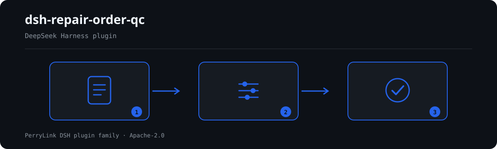

# dsh-repair-order-qc — Registro de órdenes de reparación de vehículos y verificación de la aritmética de liquidación

[English](README.md) · [简体中文](README-zh.md) · [Español](README-es.md) · [Português](README-pt.md) · [हिन्दी](README-hi.md)

```sh
dsh plugin --profile <name> add dsh-repair-order-qc
```


[](https://dsh.market/)
[](https://dshfind.com/en/plugins/PerryLink/dsh-repair-order-qc?ref=badge)

`dsh-repair-order-qc` lee un registro de órdenes de reparación de vehículos —la cabecera del vehículo más una fila por línea de trabajo— y comprueba la completitud y la aritmética de ese propio registro: que se registren la manifestación del cliente y el trabajo realizado, que la columna del nombre del trabajo esté rellenada, que la cantidad, el precio unitario y el importe se puedan analizar, que el importe sea igual a la cantidad × el precio unitario, que la suma de los importes de las líneas cuadre con la cifra de liquidación, que la cifra de liquidación sea igual a las piezas más la mano de obra menos el descuento, que la fecha de recepción no sea posterior a la fecha de entrega, que el número de orden sea único dentro del registro y que no quede ninguna marca de plantilla en la columna del nombre del trabajo.

## Install

```sh
dsh plugin --profile <name> add dsh-repair-order-qc
dsh --profile <name> --dump-config | grep 'dsh-repair-order-qc'
```

## Cómo se ve la salida



*Resumen del flujo: llamada → plugin → resultado. Los ejemplos siguientes usan la superficie de comandos real.*


Salida real de este plugin sobre su propio fixture de prueba `RO-001` — no es un montaje. El paquete de reglas no inventa citas, así que cada hallazgo nombra la cláusula aplicada y advierte que su texto no se obtuvo.

## Qué responde

### Ejemplos

La tabla siguiente es el conjunto de ejemplos: la primera fila es el caso detallado y las demás son casos breves.

| Usted pregunta | Qué responde |
|---|---|
| Una línea dice cantidad 2, precio unitario 180 y un importe de 400, ¿lo nota la comprobación? | Sí. `RO-002` señala esa fila, porque 2 × 180 = 360 mientras que la celda del importe dice 400. La regla solo se ejecuta cuando la cantidad, el precio unitario y el importe se pueden analizar como números, y su tolerancia es `0.01` para el redondeo. No juzga si el precio unitario es razonable ni si el concepto debía cobrarse. |
| Los importes de las líneas no cuadran con la cifra de liquidación escrita en la cabecera del material. | `RO-003` suma la columna `amount` y compara ese total con la cifra de liquidación `total` que declara la cabecera del material, e informa de cuántas filas sumó y de la magnitud de la diferencia. La tolerancia es `0.01`. Solo hace esa suma; no juzga si los cargos individuales son razonables. |
| Nuestras órdenes no traen total de piezas ni total de mano de obra, ¿aun así puede decirme que la cifra de liquidación está mal? | No, y lo dice. `RO-004` comprueba piezas más mano de obra menos descuento contra la cifra de liquidación y se informa a sí misma en `skipped` cuando el material no trae los totales `partsTotal` y `laborTotal`, en lugar de suponer una composición. Su columna de descuento significa un importe de reducción; un registro que anote una tasa de descuento debería desactivar la regla o usar otra comprobación. |
| La fecha de entrega es anterior a la fecha de recepción. | `RO-005` señala esa fila: compara la fecha de recepción con la fecha de entrega y señala la fila cuando la recepción es posterior a la entrega. El mismo día cuenta como no posterior, una fecha que no puede analizar se informa en su propia fila en lugar de pasarse por alto, y no juzga si la reparación duró un tiempo razonable. |
| El mismo número de orden aparece en dos filas. | `RO-006` señala el número repetido, porque duplicaría las tarifas y rompería el vínculo entre una orden y su archivo; al comparar se ignoran los espacios. Una orden repartida en varias líneas de trabajo es una forma legítima: distinga esas filas en la columna del nombre del trabajo en lugar de repetir el número. La regla solo comprueba la unicidad. |
| La celda del nombre del trabajo aún dice 【】 o 待填. | `RO-007` señala la marca de plantilla que queda, porque una orden sin un trabajo real no se puede liquidar. La lista de `terms` que busca es la de su propio paquete de reglas y puede ajustarse a su plantilla. Solo comprueba si esas cadenas literales aparecen, no si la redacción es adecuada. |

## Normas que sigue

| Documento | Número | Reglas que lo citan |
|---|---|---|
| 《机动车维修管理规定》 | 交通运输部令2021年第18号（2005 年公布，经 2015、2016、2019、2021 年四次修正，自 2005 年 8 月 1 日起施行） | RO-001, RO-002, RO-003, RO-004, RO-005, RO-006, RO-007 |

**Boundary:** this plugin checks a **机动车维修工单** for arithmetic and completeness — that the customer's
report and the work performed are recorded, that a line's amount equals quantity × unit price, that the line
amounts total the settlement figure, that the settlement figure equals parts plus labour less discount, that
delivery does not precede receipt, that work-order numbers are used consistently, and that no placeholder
survives. It does **not** decide whether a repair was necessary, whether a charge is reasonable, whether there
was over-servicing, or whether the work was done properly.

> ### ⚠️ It checks arithmetic, not the repair
>
> A work order with perfectly consistent figures for work that should never have been sold passes this plugin.
> Judging necessity and price needs the vehicle's actual condition, the technical standards and the repair
> contract — this plugin has none of them.
>
> **The labour rate comes from the register or your configuration.** No rate standard is built in. The plugin
> does not check whether a part is genuine either; it reports what the register says.
>
> Two arithmetic rules read the register's composition, and **both say so when they cannot run**:
>
> - `RO-002` verifies `金额 = 数量 × 单价`, and reports itself in `skipped` unless all three cells parse. Its
>   tolerance is `0.01`, for rounding.
> - `RO-004` verifies `配件费合计 + 工时费合计 − 折扣 = 结算总额`. The subtraction is expressed as a **per-term
>   sign** in the rule pack (`signs: [1, 1, -1]`) rather than a negative scale, so the finding reads like the
>   arithmetic a person would write. A register with no parts/labour breakdown leaves the rule unrun instead of
>   assuming a composition.
>
> **Every `excerpt` in the rule pack says, in so many words, that the clause text was not obtained.** The regime
> lives in 《机动车维修管理规定》 and GB/T 16739. The verification pass could not retrieve verbatim clause
> text, so the pack states the gap in the `excerpt` field itself and keeps every rule at `warn` or `info`.
> **When the texts are in hand, replace each `excerpt` with the real clause and raise `kind` to `direct`.**

## Compatibility

| Superficie | Estado |
|---|---|
| Harness | Rango de peers `>=0.1.2-rc.1 <0.2.0 \|\| >=0.2.0-0 <0.3.0` — verificado para aceptar tanto `0.2.0-rc.2` como `0.2.1-rc.2`. **`engines.dsh` se declara como `>=0.2.1-0 <0.3.0`** y el host lo aplica desde 0.2.1 |
| Node | `^22.19.0 || >=24.0.0` |
| Plataformas | Todas (ESM puro; sin código nativo, sin red, sin llamada al modelo) |
| Modo de herramienta | Funciona en `native` y `ptc`; para un directorio completo use `ptc` |

## What it does

La tabla de reglas, los campos y el comportamiento detallado están en [README.md](README.md#what-it-does) (versión principal en inglés). El plugin sólo enumera divergencias literales frente a las cláusulas citadas e indica en `skipped` cada comprobación que no pudo ejecutarse.

## Configuration

Todos los parámetros ajustables viven en el esquema Schemastery de `src/config.ts`, por lo que se cambian desde `cordis.yml` sin tocar el código; los umbrales por regla están en el paquete de reglas bajo `rules/`.

| Clave | Tipo | Predeterminado | Descripción |
|---|---|---|---|
| `rulesFile` | string | `rules/repair-order-qc.yaml` | Ruta del paquete de reglas, relativa a la raíz del paquete |
| `disabledRules` | string[] | `[]` | Ids de reglas que se dejan de ejecutar; cada una aparece en `skipped` |
| `onlyRules` | string[] | `[]` | Ejecutar solo estas reglas; vacío ejecuta todas |
| `skipNotes` | string | `""` | Nota añadida a cada motivo de `skipped` |
| `timeoutMs` | number | `120000` | Presupuesto de tiempo de espera cooperativo de la herramienta |

## Material format

Acepta JSON o YAML. El ejemplo completo de campos está en [README.md](README.md#material-format) (versión principal en inglés). Los campos son opcionales en la capa de lectura y los valida el motor, de modo que una exportación parcial produce hallazgos sobre lo que falta en lugar de un fallo.

## Rule sources

Los datos de las reglas están separados del código: cada regla lleva documento, número, cláusula en la numeración propia de la fuente, extracto literal y URL de origen. El cargador impone que el extracto sea una cita real de al menos ocho caracteres y que una comprobación basada sólo en un principio general (`kind: derived-from-principle`, tope `warn`) o en una política local (`kind: institutional-configuration`, tope `info`) nunca se declare `error`.

Los límites verificados y las conclusiones deliberadamente **no** afirmadas están en [README.md](README.md#rule-sources) (versión principal en inglés) y en `rules/evidence/`.

## Troubleshooting

- **El plugin se instala pero la herramienta no aparece**: compruebe que `main` resuelve a `lib/index.mjs` y que `pnpm run build` lo generó.
- **`dsh plugin add` rechaza el paquete**: la faixa de peers cubre `0.1.x` y `0.2.x`; fuera de ella, conceda una exención explícita con `dsh plugin --profile <name> allow-version <pkg@ver> --dsh-version <runtime> --accept-risk`.
- **Una regla no se ejecutó**: lea el arreglo `skipped`.
- **`check` informa `manifest-peers` como fallo**: es un problema conocido de `dsh-plugin-dev`; el runtime aplica la compatibilidad al instalar.
- **Los horarios parecen desplazados**: toda la aritmética es de hora local sobre las cadenas entregadas.

## Development

```sh
pnpm install
pnpm run typecheck
pnpm test
pnpm run build
node ../scripts/sync-shared.mjs dsh-repair-order-qc
```

El último comando copia el kit compartido de `../_shared` a `src/shared/`; vuelva a ejecutarlo tras cada cambio compartido.

## PerryLink DSH Plugin Family

Este proyecto forma parte de la familia de plugins de DeepSeek Harness de [PerryLink](https://github.com/PerryLink). El registro permanece plegado abajo para que cada README conserve una primera pantalla corta; expándelo para ver cada fila y su estado.

<details>
<summary>Expandir todos los plugins</summary>

| Plugin | Estado |
|---|---|
| **[dsh-aqua-input-check](https://github.com/PerryLink/dsh-aqua-input-check)** |  |
| **[dsh-archive-check](https://github.com/PerryLink/dsh-archive-check)** |  |
| **[dsh-auto-review](https://github.com/PerryLink/dsh-auto-review)** |  |
| **[dsh-autotier](https://github.com/PerryLink/dsh-autotier)** |  |
| **[dsh-bid-ca-precheck](https://github.com/PerryLink/dsh-bid-ca-precheck)** |  |
| **[dsh-bid-qual-check](https://github.com/PerryLink/dsh-bid-qual-check)** |  |
| **[dsh-cert-mcp](https://github.com/PerryLink/dsh-cert-mcp)** |  |
| **[dsh-checkpoint-rewind](https://github.com/PerryLink/dsh-checkpoint-rewind)** |  |
| **[dsh-click](https://github.com/PerryLink/dsh-click)** |  |
| **[dsh-composer-history](https://github.com/PerryLink/dsh-composer-history)** |  |
| **[dsh-contract-stance](https://github.com/PerryLink/dsh-contract-stance)** |  |
| **[dsh-customs-doc-check](https://github.com/PerryLink/dsh-customs-doc-check)** |  |
| **[dsh-data-quality](https://github.com/PerryLink/dsh-data-quality)** |  |
| **[dsh-demurrage-ledger](https://github.com/PerryLink/dsh-demurrage-ledger)** |  |
| **[dsh-doublecheck](https://github.com/PerryLink/dsh-doublecheck)** |  |
| **[dsh-drill-script-check](https://github.com/PerryLink/dsh-drill-script-check)** |  |
| **[dsh-eia-guide-check](https://github.com/PerryLink/dsh-eia-guide-check)** |  |
| **[dsh-emergency-plan](https://github.com/PerryLink/dsh-emergency-plan)** |  |
| **[dsh-essay-rubric-check](https://github.com/PerryLink/dsh-essay-rubric-check)** |  |
| **[dsh-evidence-check](https://github.com/PerryLink/dsh-evidence-check)** |  |
| **[dsh-export-ctl-check](https://github.com/PerryLink/dsh-export-ctl-check)** |  |
| **[dsh-fast](https://github.com/PerryLink/dsh-fast)** |  |
| **[dsh-fmea-table-check](https://github.com/PerryLink/dsh-fmea-table-check)** |  |
| **[dsh-forecast-penalty](https://github.com/PerryLink/dsh-forecast-penalty)** |  |
| **[dsh-fund-research](https://github.com/PerryLink/dsh-fund-research)** |  |
| **[dsh-github](https://github.com/PerryLink/dsh-github)** |  |
| **[dsh-gongwen-flow-check](https://github.com/PerryLink/dsh-gongwen-flow-check)** |  |
| **[dsh-gongwen-word-check](https://github.com/PerryLink/dsh-gongwen-word-check)** |  |
| **[dsh-guard-plan-qc](https://github.com/PerryLink/dsh-guard-plan-qc)** |  |
| **[dsh-hazchem-check](https://github.com/PerryLink/dsh-hazchem-check)** |  |
| **[dsh-hazplan-check](https://github.com/PerryLink/dsh-hazplan-check)** |  |
| **[dsh-hidden-risk-map](https://github.com/PerryLink/dsh-hidden-risk-map)** |  |
| **[dsh-hs-classify](https://github.com/PerryLink/dsh-hs-classify)** |  |
| **[dsh-icd-rule-check](https://github.com/PerryLink/dsh-icd-rule-check)** |  |
| **[dsh-industry-research](https://github.com/PerryLink/dsh-industry-research)** |  |
| **[dsh-lawcite-adapter](https://github.com/PerryLink/dsh-lawcite-adapter)** |  |
| **[dsh-laya](https://github.com/PerryLink/dsh-laya)** |  |
| **[dsh-lc-doc-check](https://github.com/PerryLink/dsh-lc-doc-check)** |  |
| **[dsh-learning-gap-check](https://github.com/PerryLink/dsh-learning-gap-check)** |  |
| **[dsh-library](https://github.com/PerryLink/dsh-library)** |  |
| **[dsh-local-ai](https://github.com/PerryLink/dsh-local-ai)** |  |
| **[dsh-lsp-actions](https://github.com/PerryLink/dsh-lsp-actions)** |  |
| **[dsh-mask](https://github.com/PerryLink/dsh-mask)** |  |
| **[dsh-mcp-panel](https://github.com/PerryLink/dsh-mcp-panel)** |  |
| **[dsh-medrec-qc](https://github.com/PerryLink/dsh-medrec-qc)** |  |
| **[dsh-memento](https://github.com/PerryLink/dsh-memento)** |  |
| **[dsh-nsfc-form-check](https://github.com/PerryLink/dsh-nsfc-form-check)** |  |
| **[dsh-nurse-record-check](https://github.com/PerryLink/dsh-nurse-record-check)** |  |
| **[dsh-observe](https://github.com/PerryLink/dsh-observe)** |  |
| **[dsh-origin-rvc-check](https://github.com/PerryLink/dsh-origin-rvc-check)** |  |
| **[dsh-ota-review-check](https://github.com/PerryLink/dsh-ota-review-check)** |  |
| **[dsh-output-styles](https://github.com/PerryLink/dsh-output-styles)** |  |
| **[dsh-paper-doc-adapter](https://github.com/PerryLink/dsh-paper-doc-adapter)** |  |
| **[dsh-permission-rules](https://github.com/PerryLink/dsh-permission-rules)** |  |
| **[dsh-permit-report-check](https://github.com/PerryLink/dsh-permit-report-check)** |  |
| **[dsh-pipeline-check](https://github.com/PerryLink/dsh-pipeline-check)** |  |
| **[dsh-pleading-draft](https://github.com/PerryLink/dsh-pleading-draft)** |  |
| **[dsh-plugin-doctor](https://github.com/PerryLink/dsh-plugin-doctor)** |  |
| **[dsh-plugin-guide](https://github.com/PerryLink/dsh-plugin-guide)** |  |
| **[dsh-plugin-kit](https://github.com/PerryLink/dsh-plugin-kit)** |  |
| **[dsh-plugin-upgrade](https://github.com/PerryLink/dsh-plugin-upgrade)** |  |
| **[dsh-policy-brief-draft](https://github.com/PerryLink/dsh-policy-brief-draft)** |  |
| **[dsh-power-loss-split](https://github.com/PerryLink/dsh-power-loss-split)** |  |
| **[dsh-power-ticket-check](https://github.com/PerryLink/dsh-power-ticket-check)** |  |
| **[dsh-ppap-check](https://github.com/PerryLink/dsh-ppap-check)** |  |
| **[dsh-protest-deadline](https://github.com/PerryLink/dsh-protest-deadline)** |  |
| **[dsh-railway-window](https://github.com/PerryLink/dsh-railway-window)** |  |
| **[dsh-repair-order-qc](https://github.com/PerryLink/dsh-repair-order-qc)** |  |
| **[dsh-research-report](https://github.com/PerryLink/dsh-research-report)** |  |
| **[dsh-review-reply-check](https://github.com/PerryLink/dsh-review-reply-check)** |  |
| **[dsh-rulefile-check](https://github.com/PerryLink/dsh-rulefile-check)** |  |
| **[dsh-safety-brief-check](https://github.com/PerryLink/dsh-safety-brief-check)** |  |
| **[dsh-score](https://github.com/PerryLink/dsh-score)** |  |
| **[dsh-session-sync](https://github.com/PerryLink/dsh-session-sync)** |  |
| **[dsh-site-log-check](https://github.com/PerryLink/dsh-site-log-check)** |  |
| **[dsh-skill-pack-security](https://github.com/PerryLink/dsh-skill-pack-security)** |  |
| **[dsh-soe-decision-check](https://github.com/PerryLink/dsh-soe-decision-check)** |  |
| **[dsh-soilwater-check](https://github.com/PerryLink/dsh-soilwater-check)** |  |
| **[dsh-sop-sync-check](https://github.com/PerryLink/dsh-sop-sync-check)** |  |
| **[dsh-spc-gbt-adapter](https://github.com/PerryLink/dsh-spc-gbt-adapter)** |  |
| **[dsh-talk](https://github.com/PerryLink/dsh-talk)** |  |
| **[dsh-tender-extract](https://github.com/PerryLink/dsh-tender-extract)** |  |
| **[dsh-tender-matrix](https://github.com/PerryLink/dsh-tender-matrix)** |  |
| **[dsh-test-drive](https://github.com/PerryLink/dsh-test-drive)** |  |
| **[dsh-ticktick](https://github.com/PerryLink/dsh-ticktick)** |  |
| **[dsh-translate](https://github.com/PerryLink/dsh-translate)** |  |
| **[dsh-warranty-calc](https://github.com/PerryLink/dsh-warranty-calc)** |  |
| **[dsh-budget](https://github.com/PerryLink/dsh-budget)** | 🧊 CONGELADO — ver el README del repositorio |
| **[dsh-claude-move](https://github.com/PerryLink/dsh-claude-move)** | 🧊 CONGELADO — ver el README del repositorio |
| **[dsh-defend](https://github.com/PerryLink/dsh-defend)** | 🧊 CONGELADO — ver el README del repositorio |
| **[dsh-draw](https://github.com/PerryLink/dsh-draw)** | 🧊 CONGELADO — ver el README del repositorio |
| **[dsh-reach](https://github.com/PerryLink/dsh-reach)** | 🧊 CONGELADO — ver el README del repositorio |
| **[dsh-background-agents](https://github.com/PerryLink/dsh-background-agents)** | 🚫 RETIRADO — ver el README del repositorio |
| **[dsh-session-pin](https://github.com/PerryLink/dsh-session-pin)** | 🚫 RETIRADO — ver el README del repositorio |
| **[dsh-team-rooms](https://github.com/PerryLink/dsh-team-rooms)** | 🚫 RETIRADO — ver el README del repositorio |

</details>

## License

[Apache License 2.0](LICENSE) © 2026 dsh-repair-order-qc contributors.
