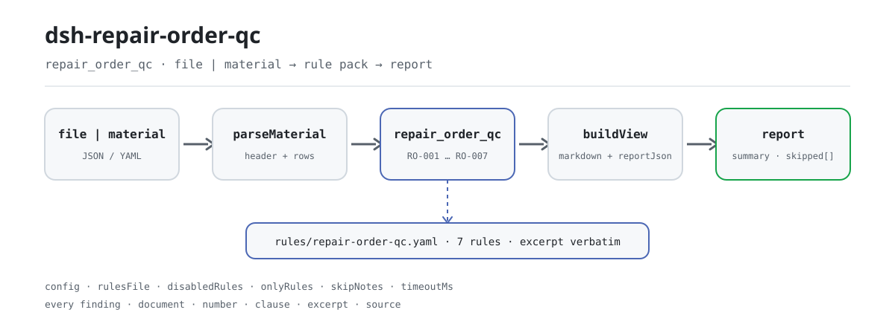

<div align="center">

<picture>
  <source media="(prefers-color-scheme: dark)" srcset="docs/assets/dsh-repair-order-qc-flow-dark.svg">
  
</picture>

# dsh-repair-order-qc

**Check one motor-vehicle repair work order and get back a line-by-line list of which row, which column, and what differs.**

A DeepSeek Harness checker for repair front desks and settlement staff: the rule pack is data, each of its seven rules carries its citation, and it lists differences only — it never rules.

[Install](#three-step-setup) · [Configuration](#configuration) · [FAQ](#faq) · [简体中文](README.md) · [English](README.en.md) · [Español](README.es.md) · [Português](README.pt.md) · [हिन्दी](README.hi.md)

[](LICENSE)
[](#compatibility)
[](https://www.npmjs.com/package/dsh-repair-order-qc)
[](https://github.com/PerryLink/dsh-repair-order-qc/actions/workflows/ci.yml)
[](#compatibility)

[](https://github.com/PerryLink/dsh-repair-order-qc/stargazers)
[](https://www.npmjs.com/package/dsh-repair-order-qc)
[](https://dshfind.com/plugins/PerryLink/dsh-repair-order-qc?ref=badge)
[](https://securityscorecards.dev/viewer/?uri=github.com/PerryLink/dsh-repair-order-qc)
[](https://dsh.market/)
[](https://gitee.com/perrylink/dsh-repair-order-qc)

```sh
dsh plugin --profile <name> add dsh-repair-order-qc
```

</div>

<sub>Community plugin, not affiliated with DeepSeek. Canonical repository: <https://github.com/PerryLink/dsh-repair-order-qc> (Gitee is a mirror).</sub>

## What it is

`dsh-repair-order-qc` reads one motor-vehicle repair work order — the vehicle header plus one row per item line — and checks that order's own completeness and arithmetic: whether the customer's report and the work performed are recorded, whether the item name column is filled, whether quantity, unit price and amount are parseable, whether amount equals quantity × unit price, whether the line amounts total the settlement figure, whether the settlement figure equals parts plus labour less discount, whether the receipt date does not fall after the delivery date, whether work-order numbers are unique within the order, and whether any template placeholder survives in the item name column.

It reads a file and returns a list: no network, no model call, no disk writes, so the same material can be checked again and again; swap the rule pack and you swap the rule set.

Whether a repair was necessary, whether a charge is reasonable, whether a part is genuine — it does not judge any of that, because that needs the vehicle's actual condition, the technical standards and the repair contract.

## Three-step setup

1. **Install** (published on npm):

   ```sh
   # npm channel (published releases)
   dsh plugin --profile web add dsh-repair-order-qc
   # tarball channel: pnpm pack in this repo, then
   dsh plugin --profile web add ./dsh-repair-order-qc-<version>.tgz
   ```

   Running from a source checkout requires `pnpm install && pnpm run build` first: `main` points at the build output `lib/index.mjs`, never at the sources.

2. **Minimal config** (sane defaults; the bundle patch inserts one row and needs nothing else):

   ```yaml
   - insert:
       - id: dsh-repair-order-qc
         name: dsh-repair-order-qc
   ```

3. **Verify it mounts**:

   ```sh
   dsh --profile web --dump-config | grep -A2 'id: dsh-repair-order-qc'
   ```

   Then run the bundled sample; the real output is (copied from `docs/assets/quickstart.log`):

   ```sh
   pnpm run build && node samples/quickstart/run.mjs
   ```

   ```text
   $ node samples/quickstart/run.mjs
   repair_order_qc: 2 issue(s) — error 0, warn 2, info 0
   skipped: 0
   ```

   The material lives in `samples/quickstart/input/RO-001-unsafe.json`, the expected summary in `samples/quickstart/expected/result.json`, and the screenshot in [docs/assets/quickstart.png](docs/assets/quickstart.png).

**Uninstall**: `dsh plugin --profile web remove dsh-repair-order-qc` (or remove the row from the profile patch).

<details>
<summary>Install from the DSH Desktop market</summary>

Every PerryLink plugin is listed in the built-in DSH Desktop market: **Market → Sources → Add source → paste** `https://perrylink-dsh-catalog.perrylink.workers.dev/catalog-source.json` **→ select**. Installation still requires the market's npm identity check and your confirmation.

</details>

## Core capabilities

- **One command checks the whole order** — it registers the `repair_order_qc` tool, accepts `file` or `material` (JSON / YAML), and runs all seven rules in one pass.
- **The rule pack is data, not code** — the seven rules live in `rules/repair-order-qc.yaml` (pack version `2026.1`); replacing that file switches the rule set without touching TypeScript.
- **Every difference is traceable** — each finding carries `document` / `number` / `clause` / `excerpt` / `source`: which document, which clause, what the text says, and where it was read from.
- **Severity follows the evidence** — only a check whose clause text was read verbatim may be `error`; a principle-only basis is capped at `warn` and a local-policy threshold at `info`. The rule-pack loader enforces this instead of trusting the author.
- **An empty issue list is not a clean bill** — every check that cannot run is reported in `skipped` with its reason (missing column, disabled by config …); nothing passes silently.
- **Differences only, no verdicts** — no compliance finding, no liability finding, no replacement for the reviewer; every report carries the disclaimer and a wording guard blocks adjudicating phrasing.
- **Local only** — no network, no model call, no disk writes; the material and the report stay on your machine and in the host's own session record.

### What the output looks like

| Field | Meaning |
|---|---|
| `summary` | counts for the `error` / `warn` / `info` tiers |
| `issueCount` / `skippedCount` | number of differences / number of checks that did not run |
| `markdown` | the human-readable list (this is what the tool renders) |
| `reportJson` | the same report as a JSON string, for downstream processing |
| `rulesetVersion` | the rule-pack version, the precondition for a reproducible report |

### Examples

**Detailed walkthrough** — tool `repair_order_qc`.

**Input**

~~~json
{"customer":"某某客户","vehicle":"某某车型","rows":[{"工单号":"WX-2026-0018","项目名称":"前制动片","客户反映":"","施工内容":""}]}
~~~

**Output**

~~~json
{
  "id": "dsh-repair-order-qc.RO-001.de09b5a6",
  "ruleId": "RO-001",
  "severity": "warn",
  "locator": {
    "row": 1,
    "field": "customerConcern"
  },
  "found": "第 1 行 customerConcern、workDone 都为空",
  "expected": "customerConcern、workDone 至少应填写一项",
  "fix": "补填客户反映与施工内容；本条只核对是否记录，不判断维修是否必要"
}
~~~

*Observed from `dsh-repair-order-qc/tests/fixtures/RO-001/RO-001-unsafe.json (cases.json expects 1×RO-001); executed parseMaterial+runCheck, checkedAt=2026-10-06T00:00:00.000Z`*

The rule pack never invents citations, so every finding names the clause it relies on and whether that basis is verbatim text or a principle.

| You ask | What it answers |
|---|---|
| A line says quantity 2, unit price 180, and an amount of 400 — does the check notice? | Yes. `RO-002` reports that row, because 2 × 180 = 360 while the amount cell says 400. The rule runs only when quantity, unit price and amount all parse as numbers, and its tolerance is `0.01` for rounding. It does not judge whether the unit price is reasonable or whether the item should have been charged at all. |
| The line amounts do not add up to the settlement figure written in the header of the material. | `RO-003` adds the `amount` column and compares that total with the settlement figure `total` stated in the material header, reporting how many rows it summed and how large the gap is. The tolerance is `0.01`. It only performs that addition; it does not judge whether the individual charges are reasonable. |
| Our work orders carry no parts total and no labour total — can the plugin still tell me the settlement figure is wrong? | No, and it says so. `RO-004` checks parts plus labour less discount against the settlement figure and reports itself in `skipped` when the material carries no `partsTotal` and `laborTotal` totals, instead of assuming a composition. Its discount column means a reduction amount; a register that records a discount rate should disable the rule or use another check. |
| The delivery date is earlier than the receipt date. | `RO-005` reports that row: it compares the receipt date with the delivery date and reports the row when receipt falls after delivery. The same day counts as not later, a date it cannot parse is reported on its own row rather than passed over in silence, and it does not judge whether the repair took a reasonable length of time. |
| The same work-order number appears on two rows. | `RO-006` reports the repeated number, because it would double-count the fees and break the link between a work order and its archive; whitespace is ignored when comparing. One work order spread over several item lines is a legitimate shape — distinguish those rows in the item name column instead of repeating the number. The rule checks uniqueness only. |
| The item name cell still reads a placeholder such as the full-width brackets or a "to be filled" marker. | `RO-007` reports the residual placeholder, because a work order with no real item cannot be settled. The `terms` list it looks for is the one in its own rule pack and can be adjusted to your template. It only checks whether those literal strings appear, not whether the wording is apt. |

### Material format

JSON and YAML are both accepted; the material is "vehicle header + one row per item line":

~~~yaml
customer: 某某客户
vehicle: 某某车型
mileage: '48600'
partsTotal: '360'
laborTotal: '200'
discount: '0'
total: '560'
rows:
  - { 工单号: WX-2026-0018, 进厂日期: 2026-03-02, 出厂日期: 2026-03-04,
      项目名称: 前制动片, 数量: '2', 单价: '180', 金额: '360',
      客户反映: 刹车时有异响, 施工内容: 更换前制动片一副并试车 }
~~~

Column names are matched case-insensitively and ignoring spaces, underscores and hyphens; the register's own column names are kept, so a finding names the column it read. Figures stated once for the whole order (the parts and labour totals, the settlement figure) may live in the header, and the arithmetic checks find them there. Fields are optional at the reader and validated by the check engine, so a partially exported material produces "missing value" differences instead of crashing. An Excel register can be converted to JSON or YAML first (in chat too, where the platform supports it); the tool only reads the material and never modifies the original.

## Rules and sources

### The seven rules

| Rule | Check | Severity | Basis kind |
|---|---|---|---|
| `RO-001` | the customer's report and the work performed are recorded at least once | warn | direct |
| `RO-002` | the amount equals quantity × unit price | warn | direct |
| `RO-003` | the line amounts total the settlement figure | warn | direct |
| `RO-004` | the total equals parts + labour − discount | warn | direct |
| `RO-005` | the delivery date is not before the receipt date | warn | derived-from-principle |
| `RO-006` | work-order numbers are unique within the order | warn | derived-from-principle |
| `RO-007` | the item name column holds no template placeholder | warn | derived-from-principle |

### The standards behind them

| Document | Number | Cited by rules |
|---|---|---|
| Provisions on the Administration of Motor Vehicle Maintenance | Ministry of Transport Order No. 18/2021 (promulgated 2005; amended four times in 2015, 2016, 2019 and 2021; in force since 1 August 2005) | RO-001, RO-002, RO-003, RO-004, RO-005, RO-006, RO-007 |

**Boundary:** this plugin checks a **motor-vehicle repair work order** for arithmetic and completeness — that the customer's report and the work performed are recorded, that a line's amount equals quantity × unit price, that the line amounts total the settlement figure, that the settlement figure equals parts plus labour less discount, that delivery does not precede receipt, that work-order numbers are used consistently, and that no placeholder survives. It does **not** decide whether a repair was necessary, whether a charge is reasonable, whether there was over-servicing, or whether the work was done properly.

> ### ⚠️ It checks arithmetic, not the repair
>
> A work order with perfectly consistent figures for work that should never have been sold passes this plugin. Judging necessity and price needs the vehicle's actual condition, the technical standards and the repair contract — this plugin has none of them.
>
> **The labour rate comes from the register or your configuration.** No rate standard is built in. The plugin does not check whether a part is genuine either; it reports what the register says.
>
> Two arithmetic rules read the register's composition, and **both say so when they cannot run**:
>
> - `RO-002` verifies `amount = quantity × unit price`, and reports itself in `skipped` unless all three cells parse. Its tolerance is `0.01`, for rounding.
> - `RO-004` verifies `parts total + labour total − discount = settlement total`. The subtraction is expressed as a **per-term sign** in the rule pack (`signs: [1, 1, -1]`) rather than a negative scale, so the finding reads like the arithmetic a person would write. A register with no parts/labour breakdown leaves the rule unrun instead of assuming a composition.
>
> **The rule pack never invents citations.** The `excerpt` of `RO-001`–`RO-004` is verbatim text obtained on 2026-10-07 (Articles 26 and 33; the verification records are in `rules/evidence/`); `RO-005`–`RO-007` have no clause that can be quoted verbatim, so their `kind` stays `derived-from-principle` and their severity is capped at `warn`. `check:citations` traces every excerpt segment back to those records, and the citation gate runs in CI.

### Rule sources and verification

Rule data lives in `rules/repair-order-qc.yaml`. Every rule carries a document, a document number, a clause in the source's own numbering, a verbatim excerpt and the URL the excerpt was read from. The loader enforces that an excerpt is a real quotation of at least eight characters, and that a check whose basis is only a general principle (`kind: derived-from-principle`, capped at `warn`) or a local policy (`kind: institutional-configuration`, capped at `info`) may never be declared `error`. A pack that overstates its basis fails at load time instead of producing a confidently worded report.

The clause numbers were checked against the full current text of the Provisions (seven chapters, 55 articles, as amended in 2021). Three findings shaped the pack, and are recorded here so a reviewer can see what was deliberately **not** claimed:

1. **`RO-005` has no explicit clause.** The Provisions contain no requirement that the delivery date must not precede the receipt date; Article 32 is about **release only after passing the completion inspection**, which says nothing about the order of two dates. The rule is therefore the register's own time consistency, its `clause` field says the regulation does not state it, and its `kind` stays `derived-from-principle` (capped at `warn`).
2. **The 2021 amendment changed exactly one thing, and not inside the cited articles.** The fourth amendment deleted one sentence from Article 53; Articles 26, 32 and 33 read the same in the 2019 and the 2021 texts. Cite "Ministry of Transport Order No. 18/2021 as amended", not the 2019 Order No. 20.
3. **"Arithmetic only" is a scope choice the text supports.** Article 26 requires the settlement list to state labour and material **separately** and to include a **cost breakdown** — it governs itemisation, detail and traceability, not price levels. Article 25's "reasonable charges" is qualitative and gives no amount; so "is the unit price reasonable" genuinely cannot be decided from a register. Article 30 prohibits **counterfeit or substandard parts** and requires parts traceability, and explicitly allows same-quality parts, so "is this part genuine" is not a test this regulation provides either.

Articles **recorded but not enabled**: Article 30 (parts traceability), Article 31 (the three inspection regimes), the archive requirements beyond Articles 32 and 33, and Article 36 (repair quality warranty periods: 20,000 km or 100 days for a whole vehicle or assembly, 5,000 km or 30 days for second-level maintenance, 2,000 km or 10 days for first-level maintenance, minor repair or special work — whichever comes first). ⚠️ **The repair quality warranty period (Article 36) is not the warranty period of the vehicle's "three guarantees"**; the two rest on different documents and must not be mixed. The full verification and the recorded-but-unused clauses are in [`rules/evidence/clause-verification-repair-regulation.md`](rules/evidence/clause-verification-repair-regulation.md) and [`rules/evidence/clause-verification-jdcwxgd.md`](rules/evidence/clause-verification-jdcwxgd.md).

## Configuration

Every tunable lives in the Schemastery schema in `src/config.ts`; change `cordis.yml` and the change takes effect, no code edit needed. Per-check thresholds live in the rule pack `rules/repair-order-qc.yaml`.

| Key | Type | Default | Description |
|---|---|---|---|
| `rulesFile` | string | `rules/repair-order-qc.yaml` | Rule-pack path, relative to the package root; replacing the file switches the rule-set version |
| `disabledRules` | string[] | `[]` | Rule ids to stop running; each appears in `skipped` |
| `onlyRules` | string[] | `[]` | Run only these rule ids; empty runs every rule |
| `skipNotes` | string | `""` | Note appended to every `skipped` reason, e.g. to name your local policy |
| `timeoutMs` | number | `120000` | Cooperative tool timeout budget, in milliseconds |

Rule-level parameters worth knowing:

- `RO-002` `resultField` / `factorFields` / `tolerance` — the line multiplication; `tolerance` defaults to `0.01`.
- `RO-003` `field` / `headerField` / `tolerance` — the column summed and the header figure it must match.
- `RO-004` `expression` — the composition, as `{ "op": "sum", "fields": [...], "signs": [1, 1, -1] }`. Change the signs if your settlement composes differently; a register that records a discount **rate** rather than an amount should disable the rule.
- `RO-007` `terms` — the placeholder strings to look for.

Profile patch override example:

~~~yaml
- insert:
    - id: dsh-repair-order-qc
      name: dsh-repair-order-qc
      config:
        disabledRules: [RO-004]
        onlyRules: []
        skipNotes: local policy 2026
        timeoutMs: 120000
~~~

## FAQ

<details>
<summary>Is the material uploaded or sent anywhere? Where is data stored?</summary>

No. It only reads the document content you pass to its tools: no network, no telemetry, no disk writes, no upload. Beyond the tool result and the DSH host's own session/log storage, this package stores nothing; that storage is controlled by the host and its retention is the host's decision — this package never adds a second copy. See [PRIVACY.md](PRIVACY.md).

</details>

<details>
<summary>The result is "0 differences" — does that mean nothing is wrong? What if a rule did not run?</summary>

"0 differences" only means **the checks that ran found no literal difference**; it does not mean the work order is compliant. Every check that cannot run is reported in `skipped` with its reason (missing column, disabled by `disabledRules` …), so an empty result cannot be read as "nothing is wrong". If the tool never appears, first confirm the `lib/index.mjs` that `main` points at exists: a source checkout needs `pnpm run build` first, while the published tarball ships the build output.

</details>

<details>
<summary>Will it give me a compliance verdict, or block a settlement?</summary>

No. It applies no compliance finding, no liability finding, and no judgement about whether a repair was necessary or a charge reasonable; it never blocks any process. Every report carries the disclaimer and a wording guard blocks adjudicating phrasing. What you get is a difference list for a human to review: which row, which column, what differs, which clause says so.

</details>

<details>
<summary>`RO-004` skipped, `RO-002` flagged a line I consider rounded, `RO-006` reported one work order twice — what now?</summary>

All three are rule-scope questions, not faults. `RO-004` runs only when the header carries both `partsTotal` and `laborTotal`; without them it reports itself in `skipped` instead of assuming a composition. Its discount column is a reduction amount, so a register that records a rate should disable it. `RO-002` tolerates `0.01` by default — raise `tolerance` if your pricing rounds more coarsely. `RO-006` checks uniqueness only: one work order spread over several item lines is normal, and if your register shares the number across lines by design, disable the rule.

</details>

<details>
<summary>What if installation reports a version conflict, or `check` reports `manifest-peers` as failed?</summary>

The peer range covers the `0.1.x` and `0.2.x` lines. If your runtime sits outside it, grant an explicit exemption: `dsh plugin --profile <name> allow-version dsh-repair-order-qc@0.2.11 --dsh-version <runtime> --accept-risk`. The `manifest-peers` failure is a known upstream issue in `dsh-plugin-dev`: the static checker compares against a hard-coded peer range that predates the 0.2 line, while installation is enforced by the runtime. More troubleshooting in [TROUBLESHOOTING.md](TROUBLESHOOTING.md).

</details>

## Security boundaries

- **Local only, no outbound surface.** No network requests, no model calls, no telemetry; `package.json#dsh.demo` also records `network: false`, `writes: []` and `external: []`.
- **A rule with insufficient basis can never be `error`.** The rule-pack loader requires an `excerpt` to be a verbatim quotation of at least eight characters and caps severity by `kind`: `derived-from-principle` at most `warn`, `institutional-configuration` at most `info`. The citation gate additionally checks that every excerpt can be traced to a verification record in `rules/evidence/`.
- **Differences only, no adjudication.** Reports assert no compliance, violation, liability or correctness; the wording guard enforces this in the render layer.
- **An empty result is not absolution.** A check that did not run must appear in `skipped` with its reason; a rule whose required fields are absent reports itself as not run instead of passing by default.
- **Registration is an effect.** The tool is registered through `ctx.tools.register`, which returns the disposer; disabling the plugin or hot-reloading removes it, leaving no dangling registration.
- **No disk writes.** Apart from the tool result and the host's own session storage, this package creates and modifies no file.

## Permissions and data

- **Permissions**: it only reads the material the caller passes (a `file` path or an inline `material`); it provides no service key and registers no client slot or HTTP route. `inject` is exactly `tools`.
- **Data**: the material participates in the comparison inside this process only; the plugin keeps no copy, no cache and no file. How the host records tool results is the host's business; this package adds no second copy.
- **Dependencies**: zero runtime dependencies (there is no `dependencies` field); the peers are Cordis, `dsh-tools` and Schemastery, all already loaded by the host.

## Known limitations

- **Literal differences only.** It does not decide which value is true, whether a repair was necessary or a charge reasonable, and it does not decide for the reviewer; when two fields conflict it lists the conflict itself.
- **`RO-005`–`RO-007` have no verbatim clause.** Their basis is a principle, `kind` is `derived-from-principle`, and severity is capped at `warn`; `RO-005`'s "delivery not before receipt" is genuinely unstated in the regulation.
- **The material shape is fixed.** It reads a "vehicle header + one row per item line" table; a work order in another shape yields no conclusion, and a missing value shows up as a missing-value difference rather than a guess.
- **The discount column means a reduction amount.** A register that records a discount rate, or whose settlement is not "parts + labour − discount", should disable `RO-004` or use another check.
- **`RO-006` reports a repeat when one work order spans several lines.** That is the intended behaviour of a uniqueness rule; if your register shares the number across lines by design, disable it.
- **The development form needs a build.** In a source checkout `main` points at `lib/index.mjs`, so `pnpm run build` must run first; the published npm tarball ships `lib/` and works as installed.
- **Time is wall-clock.** Every date computation is wall-clock arithmetic on the input strings, with no time-zone conversion; offsets in the input never participate in a comparison.
- **A known false positive in the upstream static checker.** `check`'s `manifest-peers` compares against a hard-coded peer range that predates the 0.2 line, which disagrees with the runtime check performed at install time.

## Interoperability with other DSH plugins

This plugin **does not interfere** with other plugins in the same profile:

- **It adds exactly one tool.** Only `repair_order_qc` is registered, via `ctx.tools.register`, which returns the disposer; it takes no bare name owned by a built-in tool and disappears on uninstall.
- **No service keys.** `inject` is only `tools`; no Cordis service key is registered, so no service-key conflict exists.
- **No slots, no routes.** The package has no browser half (no `client/`), registers no client slot key and no `webServer` prefix.
- **The patch layer inserts its own row only.** `cordis.patch.yml` appends the single `id: dsh-repair-order-qc` row and never overwrites the `config` of a built-in or another plugin's row.
- **No global rewrites.** No prototype patching, no `process.env` writes, no global fetch replacement.
- **Division of labour, not competition, with sibling checkers.** The same material can go to other checkers: this plugin checks the work order's own arithmetic and completeness; the vehicle's "three guarantees" are `dsh-warranty-calc`'s scope (**a repair quality warranty period is not a three-guarantees warranty period** — different bases); parts traceability is outside this plugin (recorded in the rule pack but not enabled). Each plugin reads its own file and produces its own report, modifying nothing and sharing no state.

## Compatibility

| Dimension | Status |
|---|---|
| Harness | Peer range `>=0.1.2-rc.1 <0.2.0 \|\| >=0.2.0-0 <0.3.0`, measured to accept both `0.2.0-rc.2` and `0.2.1-rc.2`; `engines.dsh` declares `>=0.2.1-0 <0.3.0`, enforced by the host since 0.2.1 |
| Node | `^22.19.0 \|\| >=24.0.0` |
| Platforms | All (plain ESM; no native code, no network, no model call) |
| Tool mode | Both `native` and `ptc`; for a month of work orders use `ptc` |
| Material | JSON / YAML; vehicle header + a `rows` list |

## Ecosystem and quality

- [Gitee mirror](https://gitee.com/perrylink/dsh-repair-order-qc) (synchronised mirror; GitHub is authoritative)
- [dshfind plugin page](https://dshfind.com/plugins/PerryLink/dsh-repair-order-qc) (install counts and ranking)
- [OpenSSF Scorecard report](https://securityscorecards.dev/viewer/?uri=github.com/PerryLink/dsh-repair-order-qc) (driven by [.github/workflows/scorecard.yml](.github/workflows/scorecard.yml))
- [DSH Market](https://dsh.market/) (listed)

## Development

```sh
pnpm install
pnpm run typecheck          # tsc --noEmit
pnpm test                   # vitest: the shared table-plugin suite plus a compliant/violating fixture pair per rule
pnpm run build              # tsdown -> lib/index.mjs + lib/index.d.mts
pnpm run verify:self-contained
pnpm run check:lockfile
pnpm run check:readmes      # README consistency: the English edition against the Chinese source
pnpm run check:citations    # every excerpt is traceable to rules/evidence/
pnpm pack                   # the published tarball
node samples/quickstart/run.mjs   # requires a build first
```

`node ../scripts/sync-shared.mjs dsh-repair-order-qc` copies the shared kit from `../_shared` into `src/shared/`; re-run it after every change to the kit. The plugin is **data-driven**: `src/model.ts` declares the table shape, the shared kit supplies the reader and the check engine, and the rule pack declares every check.

Directory layout:

| Path | Purpose |
|---|---|
| `src/index.ts` | function-plugin entry: `name` / `inject` / `Config` / `apply`, registers `repair_order_qc` and resolves the rule pack |
| `src/config.ts` | Schemastery schema; every tunable lives here |
| `src/model.ts` | table shape and material contract: column aliases, the `rows` key, header fields; `parseMaterial` / `runCheck` come from the shared kit |
| `src/view.ts` | the model-facing report projection; `output.schema` mirrors it |
| `src/shared/` | the shared kit (rule-pack loader, report shape, YAML subset, calendar arithmetic, wording guard, table helpers), copied in rather than imported |
| `rules/repair-order-qc.yaml` | the rule pack, 7 rules; `rules/evidence/` holds the verification record for every citation |
| `tests/` | vitest; a compliant/violating fixture pair per rule |

Topics: `deepseek-harness`, `dsh`, `dsh-plugin`, `cordis`, `repair`, `order`

README images are generated programmatically by [`scripts/gen-readme-assets.py`](scripts/gen-readme-assets.py) (Python + Pillow, a light/dark SVG pipeline pair) and can be regenerated at any time; the older single-version `dsh-repair-order-qc-flow.svg`, the terminal screenshot and the demo GIF are kept untouched so existing external links never break.

## Family and thanks

This project is a member of the DeepSeek Harness plugin family maintained by [PerryLink](https://github.com/PerryLink) (all Apache-2.0). If this plugin helped you, **give it a star** — it unlocks nothing, but it makes the next person find it sooner.

- [@PerryLink](https://github.com/PerryLink) — creator and maintainer: the rule pack and check core, the citation gate and verification records, the `repair_order_qc` tool, and the five-language docs.

Choose a checker by material (the full family index): <https://perrylink.github.io/zh/checkers/choose/> · [all plugins](https://github.com/PerryLink)

## License

[LICENSE](LICENSE) (Apache License 2.0) © 2026 dsh-repair-order-qc contributors

<p align="center"><sub>Apache-2.0 · Community plugin, not affiliated with DeepSeek.</sub></p>
