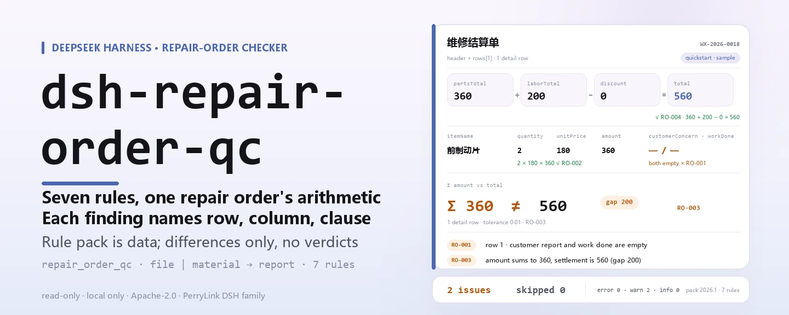

<div align="center">

<picture>
  <source media="(prefers-color-scheme: dark)" srcset="docs/assets/dsh-repair-order-qc-hero-en-dark.webp">
  
</picture>

# dsh-repair-order-qc

**एक मोटर वाहन मरम्मत कार्य-आदेश की जाँच करें और पंक्ति-दर-पंक्ति सूची पाएँ: कौन-सी पंक्ति, कौन-सा कॉलम और क्या अंतर है।**

मरम्मत केंद्र के रिसेप्शन और बिलिंग के लिए DeepSeek Harness चेकर: नियम पैक डेटा है, इसके सातों नियमों के साथ उनका उद्धरण आता है, और यह केवल अंतर गिनाता है — कभी फ़ैसला नहीं करता।

[इंस्टॉल](#तीन-चरणों-में-शुरुआत) · [कॉन्फ़िगरेशन](#कॉन्फ़िगरेशन) · [FAQ](#faq) · [简体中文](README.md) · [English](README.en.md) · [Español](README.es.md) · [Português](README.pt.md) · [हिन्दी](README.hi.md)

[](LICENSE)
[](#संगतता)
[](https://www.npmjs.com/package/dsh-repair-order-qc)
[](https://github.com/PerryLink/dsh-repair-order-qc/actions/workflows/ci.yml)
[](#संगतता)

[](https://github.com/PerryLink/dsh-repair-order-qc/stargazers)
[](https://www.npmjs.com/package/dsh-repair-order-qc)
[](https://dshfind.com/plugins/PerryLink/dsh-repair-order-qc?ref=badge)
[](https://securityscorecards.dev/viewer/?uri=github.com/PerryLink/dsh-repair-order-qc)
[](https://dsh.market/)
[](https://gitee.com/perrylink/dsh-repair-order-qc)

```sh
dsh plugin --profile <name> add dsh-repair-order-qc
```

</div>

<sub>समुदाय द्वारा बनाया गया प्लगइन, DeepSeek से संबद्ध नहीं। मुख्य रेपो: <https://github.com/PerryLink/dsh-repair-order-qc> (Gitee एक मिरर है)।</sub>

## यह क्या है

`dsh-repair-order-qc` एक मोटर वाहन मरम्मत कार्य-आदेश पढ़ता है — वाहन हेडर और प्रत्येक मद के लिए एक पंक्ति — और उसी आदेश की पूर्णता तथा अंकगणित जाँचता है: ग्राहक की शिकायत और किया गया कार्य दर्ज है या नहीं, मद-नाम कॉलम भरा है या नहीं, मात्रा, इकाई मूल्य और राशि पढ़ी जा सकती है या नहीं, राशि = मात्रा × इकाई मूल्य है या नहीं, पंक्तियों की राशियों का योग निपटान राशि से मेल खाता है या नहीं, निपटान राशि = पुर्ज़े + श्रम − छूट है या नहीं, प्रवेश तिथि निकास तिथि के बाद नहीं है या नहीं, कार्य-आदेश संख्या आदेश के भीतर अद्वितीय है या नहीं, और मद-नाम कॉलम में कोई टेम्पलेट प्लेसहोल्डर बचा है या नहीं।

यह फ़ाइल पढ़ता है और सूची देता है: न नेटवर्क, न मॉडल कॉल, न डिस्क पर लेखन, इसलिए वही सामग्री बार-बार जाँची जा सकती है; नियम पैक बदलिए और नियम-समूह बदल जाता है।

मरम्मत आवश्यक थी या नहीं, शुल्क उचित है या नहीं, पुर्ज़ा असली है या नहीं — यह इनमें से कुछ भी तय नहीं करता, क्योंकि उसके लिए वाहन की वास्तविक स्थिति, तकनीकी मानक और मरम्मत अनुबंध चाहिए।

<picture>
  <source media="(prefers-color-scheme: dark)" srcset="docs/assets/dsh-repair-order-qc-flow-v5-dark.svg">
  
</picture>

## तीन चरणों में शुरुआत

1. **इंस्टॉल करें** (npm पर प्रकाशित):

   ```sh
   # npm चैनल (प्रकाशित संस्करण)
   dsh plugin --profile web add dsh-repair-order-qc
   # tarball चैनल: इस रेपो में pnpm pack के बाद
   dsh plugin --profile web add ./dsh-repair-order-qc-<version>.tgz
   ```

   स्रोत checkout से चलाने के लिए पहले `pnpm install && pnpm run build` आवश्यक है: `main` बिल्ड आउटपुट `lib/index.mjs` की ओर इशारा करता है, स्रोत की ओर नहीं।

2. **न्यूनतम कॉन्फ़िग** (डिफ़ॉल्ट ही काफ़ी हैं; bundle patch केवल एक पंक्ति जोड़ता है):

   ```yaml
   - insert:
       - id: dsh-repair-order-qc
         name: dsh-repair-order-qc
   ```

3. **जाँचें कि माउंट हुआ**:

   ```sh
   dsh --profile web --dump-config | grep -A2 'id: dsh-repair-order-qc'
   ```

   फिर साथ दिया नमूना चलाएँ; वास्तविक आउटपुट है (जैसा `docs/assets/quickstart.log` में दर्ज है):

   ```sh
   pnpm run build && node samples/quickstart/run.mjs
   ```

   ```text
   $ node samples/quickstart/run.mjs
   repair_order_qc: 2 issue(s) — error 0, warn 2, info 0
   skipped: 0
   ```

   सामग्री `samples/quickstart/input/RO-001-unsafe.json` में, अपेक्षित सारांश `samples/quickstart/expected/result.json` में और स्क्रीनशॉट [docs/assets/quickstart.png](docs/assets/quickstart.png) में है।

**अनइंस्टॉल**: `dsh plugin --profile web remove dsh-repair-order-qc` (या प्रोफ़ाइल पैच से वह पंक्ति हटा दें)।

<details>
<summary>DSH Desktop मार्केट से इंस्टॉल करें</summary>

हर PerryLink प्लगइन DSH Desktop के अंतर्निहित मार्केट में सूचीबद्ध है: **मार्केट → स्रोत → स्रोत जोड़ें → चिपकाएँ** `https://perrylink-dsh-catalog.perrylink.workers.dev/catalog-source.json` **→ चुनें**। इंस्टॉल के लिए मार्केट की npm पहचान जाँच और आपकी पुष्टि अब भी आवश्यक है।

</details>

## मुख्य क्षमताएँ

- **एक कमांड पूरा आदेश जाँचता है** — `repair_order_qc` टूल पंजीकृत करता है, `file` या `material` (JSON / YAML) स्वीकार करता है और सातों नियम एक ही बार में चलाता है।
- **नियम पैक डेटा है, कोड नहीं** — सातों नियम `rules/repair-order-qc.yaml` में हैं (पैक संस्करण `2026.1`); उस फ़ाइल को बदलने से TypeScript छुए बिना नियम-समूह बदल जाता है।
- **हर अंतर का स्रोत मिलता है** — हर निष्कर्ष के साथ `document` / `number` / `clause` / `excerpt` / `source` आता है: कौन-सा दस्तावेज़, कौन-सी धारा, पाठ क्या कहता है और वह कहाँ से पढ़ा गया।
- **गंभीरता प्रमाण के अनुसार** — केवल वही जाँच `error` हो सकती है जिसकी धारा का पाठ शब्दशः पढ़ा गया हो; केवल सिद्धांत पर आधारित जाँच अधिकतम `warn` और स्थानीय नीति की सीमा अधिकतम `info` तक सीमित है। नियम पैक लोडर इसे लागू करता है, लेखक पर भरोसा नहीं करता।
- **खाली सूची प्रमाणपत्र नहीं** — जो जाँच नहीं चल सकती, वह कारण के साथ `skipped` में दर्ज होती है (कॉलम अनुपस्थित, कॉन्फ़िग से बंद …); कुछ भी चुपचाप पास नहीं होता।
- **केवल अंतर, कोई निर्णय नहीं** — कोई अनुपालन निष्कर्ष नहीं, कोई दायित्व निर्धारण नहीं, समीक्षक का विकल्प नहीं; हर रिपोर्ट के साथ अस्वीकरण रहता है और शब्द-रक्षक निर्णायक भाषा रोकता है।
- **केवल स्थानीय** — न नेटवर्क, न मॉडल कॉल, न डिस्क लेखन; सामग्री और रिपोर्ट आपकी मशीन तथा होस्ट के अपने सत्र रिकॉर्ड में ही रहते हैं।

### आउटपुट कैसा दिखता है

| फ़ील्ड | अर्थ |
|---|---|
| `summary` | `error` / `warn` / `info` तीन स्तरों की गिनती |
| `issueCount` / `skippedCount` | अंतरों की संख्या / न चली जाँचों की संख्या |
| `markdown` | मनुष्य के लिए सूची (टूल यही रेंडर करता है) |
| `reportJson` | वही रिपोर्ट JSON स्ट्रिंग के रूप में, आगे की प्रक्रिया के लिए |
| `rulesetVersion` | नियम पैक संस्करण, पुनरुत्पाद्य रिपोर्ट की पूर्वशर्त |

### उदाहरण

**विस्तृत उदाहरण** — टूल `repair_order_qc`।

**इनपुट**

~~~json
{"customer":"某某客户","vehicle":"某某车型","rows":[{"工单号":"WX-2026-0018","项目名称":"前制动片","客户反映":"","施工内容":""}]}
~~~

**आउटपुट**

~~~json
{
  "id": "dsh-repair-order-qc.RO-001.de09b5a6",
  "ruleId": "RO-001",
  "severity": "warn",
  "locator": {
    "row": 1,
    "field": "customerConcern"
  },
  "found": "第 1 行 customerConcern、workDone 都为空",
  "expected": "customerConcern、workDone 至少应填写一项",
  "fix": "补填客户反映与施工内容；本条只核对是否记录，不判断维修是否必要"
}
~~~

*Observed from `dsh-repair-order-qc/tests/fixtures/RO-001/RO-001-unsafe.json (cases.json expects 1×RO-001); executed parseMaterial+runCheck, checkedAt=2026-10-06T00:00:00.000Z`*

नियम पैक उद्धरण नहीं गढ़ता, इसलिए हर निष्कर्ष उस धारा का नाम देता है जिस पर वह टिका है, और यह भी कि वह आधार शब्दशः पाठ है या सिद्धांत।

| आप पूछते हैं | यह क्या उत्तर देता है |
|---|---|
| एक पंक्ति में मात्रा 2, इकाई मूल्य 180 और राशि 400 लिखी है — जाँच को पता चलेगा? | हाँ। `RO-002` उस पंक्ति की ओर इशारा करता है, क्योंकि 2 × 180 = 360 जबकि राशि कॉलम 400 कहता है। यह नियम केवल तब चलता है जब मात्रा, इकाई मूल्य और राशि तीनों संख्या के रूप में पढ़े जा सकें, और इसकी सहनशीलता `0.01` है (पूर्णांकन के लिए)। यह न तय करता है कि इकाई मूल्य उचित है, न यह कि मद का शुल्क लिया जाना चाहिए था। |
| पंक्तियों की राशियाँ सामग्री के हेडर में लिखी निपटान राशि से मेल नहीं खातीं। | `RO-003` `amount` कॉलम जोड़ता है और उस योग की तुलना सामग्री हेडर में घोषित निपटान राशि `total` से करता है, तथा बताता है कि कितनी पंक्तियाँ जोड़ी गईं और अंतर कितना है। सहनशीलता `0.01` है। यह केवल वह जोड़ करता है; व्यक्तिगत शुल्कों की उचितता नहीं जाँचता। |
| हमारे कार्य-आदेशों में पुर्ज़ों का योग और श्रम का योग नहीं है — फिर भी बता सकते हैं कि निपटान राशि गलत है? | नहीं, और यह बात कह भी देता है। `RO-004` पुर्ज़े + श्रम − छूट की निपटान राशि से तुलना करता है और जब सामग्री में `partsTotal` व `laborTotal` न हों तो स्वयं को `skipped` में दर्ज करता है, कोई संरचना मान नहीं लेता। इसका छूट कॉलम छूट की राशि है; जो रजिस्टर छूट की दर लिखता है उसे यह नियम बंद करना चाहिए या दूसरी जाँच अपनानी चाहिए। |
| निकास तिथि प्रवेश तिथि से पहले है। | `RO-005` उस पंक्ति की ओर इशारा करता है: यह प्रवेश तिथि की निकास तिथि से तुलना करता है और प्रवेश के बाद होने पर पंक्ति दर्ज करता है। एक ही दिन को बाद नहीं माना जाता, जो तिथि पढ़ी न जा सके वह अपनी पंक्ति में दर्ज होती है, चुपचाप छोड़ी नहीं जाती; यह नहीं तय करता कि मरम्मत में उचित समय लगा या नहीं। |
| वही कार्य-आदेश संख्या दो पंक्तियों में है। | `RO-006` दोहराई गई संख्या दर्ज करता है, क्योंकि इससे शुल्क दोबारा गिने जाएँगे और आदेश का अपने अभिलेख से संबंध टूटेगा; तुलना में रिक्त स्थान अनदेखे रहते हैं। एक ही कार्य-आदेश को कई मद-पंक्तियों में लिखना वैध रूप है — ऐसी पंक्तियों को मद-नाम कॉलम में अलग पहचानें, संख्या न दोहराएँ। यह नियम केवल अद्वितीयता जाँचता है। |
| मद-नाम कॉलम में अब भी टेम्पलेट प्लेसहोल्डर (पूर्ण-चौड़ाई कोष्ठक या «भरना है») है। | `RO-007` बचा हुआ प्लेसहोल्डर दर्ज करता है, क्योंकि वास्तविक मद के बिना आदेश का निपटान नहीं हो सकता। यह जिन `terms` को खोजता है वे उसके अपने नियम पैक की सूची हैं और आपके टेम्पलेट के अनुसार बदली जा सकती हैं। यह केवल देखता है कि ये शब्दकोश मौजूद हैं या नहीं, यह नहीं कि शब्दावली उपयुक्त है या नहीं। |

### सामग्री का प्रारूप

JSON और YAML दोनों स्वीकार हैं; सामग्री है «वाहन हेडर + प्रत्येक मद के लिए एक पंक्ति»:

~~~yaml
customer: 某某客户
vehicle: 某某车型
mileage: '48600'
partsTotal: '360'
laborTotal: '200'
discount: '0'
total: '560'
rows:
  - { 工单号: WX-2026-0018, 进厂日期: 2026-03-02, 出厂日期: 2026-03-04,
      项目名称: 前制动片, 数量: '2', 单价: '180', 金额: '360',
      客户反映: 刹车时有异响, 施工内容: 更换前制动片一副并试车 }
~~~

कॉलम नाम बड़े-छोटे अक्षर का भेद किए बिना और रिक्त स्थान, अंडरस्कोर व हाइफ़न छोड़कर मिलाए जाते हैं; रजिस्टर के अपने कॉलम नाम सुरक्षित रहते हैं, इसलिए निष्कर्ष उसी कॉलम का नाम देता है जिसे उसने पढ़ा। पूरे आदेश के लिए एक बार लिखी संख्याएँ (पुर्ज़ों और श्रम का योग, निपटान राशि) हेडर में रह सकती हैं और अंकगणितीय जाँचें वहीं उन्हें पा लेती हैं। पढ़ने की परत पर फ़ील्ड वैकल्पिक हैं और जाँच इंजन उन्हें सत्यापित करता है, इसलिए आधा निर्यात की गई सामग्री क्रैश के बजाय «अनुपस्थित मान» जैसे अंतर देती है। Excel रजिस्टर को पहले JSON या YAML में बदला जा सकता है (चैट में भी, यदि प्लेटफ़ॉर्म अनुमति दे); टूल केवल सामग्री पढ़ता है, मूल फ़ाइल नहीं बदलता।

## नियम और स्रोत

### सात नियम

| नियम | जाँच | गंभीरता | आधार प्रकार |
|---|---|---|---|
| `RO-001` | ग्राहक की शिकायत और किया गया कार्य कम-से-कम एक बार दर्ज हो | warn | direct |
| `RO-002` | राशि = मात्रा × इकाई मूल्य | warn | direct |
| `RO-003` | पंक्तियों की राशियों का योग निपटान राशि से मेल खाए | warn | direct |
| `RO-004` | कुल = पुर्ज़े + श्रम − छूट | warn | direct |
| `RO-005` | निकास तिथि प्रवेश तिथि से पहले न हो | warn | derived-from-principle |
| `RO-006` | कार्य-आदेश संख्या आदेश के भीतर अद्वितीय हो | warn | derived-from-principle |
| `RO-007` | मद-नाम कॉलम में टेम्पलेट प्लेसहोल्डर न बचे | warn | derived-from-principle |

### जिन मानकों पर यह टिका है

| दस्तावेज़ | संख्या | इसे उद्धृत करने वाले नियम |
|---|---|---|
| मोटर वाहन मरम्मत प्रशासन विनियम | परिवहन मंत्रालय आदेश संख्या 18/2021 (2005 में प्रख्यापित; 2015, 2016, 2019 और 2021 में चार बार संशोधित; 1 अगस्त 2005 से प्रभावी) | RO-001, RO-002, RO-003, RO-004, RO-005, RO-006, RO-007 |

**सीमा:** यह प्लगइन एक **मोटर वाहन मरम्मत कार्य-आदेश** के अंकगणित और पूर्णता की जाँच करता है — ग्राहक की शिकायत और किया गया कार्य दर्ज है, पंक्ति की राशि = मात्रा × इकाई मूल्य है, पंक्तियों का योग निपटान राशि से मेल खाता है, निपटान राशि = पुर्ज़े + श्रम − छूट है, निकास प्रवेश से पहले नहीं है, कार्य-आदेश संख्या सुसंगत है और कोई प्लेसहोल्डर नहीं बचा। यह **नहीं** तय करता कि मरम्मत आवश्यक थी, शुल्क उचित है, अधिक-बिक्री हुई या कार्य ठीक से हुआ।

> ### ⚠️ यह अंकगणित जाँचता है, मरम्मत नहीं
>
> जिस कार्य को कभी बेचना ही नहीं चाहिए था, उसके आँकड़े पूरी तरह सुसंगत हों तो वह आदेश इस प्लगइन से पास हो जाता है। आवश्यकता और मूल्य का निर्णय वाहन की वास्तविक स्थिति, तकनीकी मानक और मरम्मत अनुबंध माँगता है — यह प्लगइन इनमें से कुछ नहीं रखता।
>
> **श्रम दर रजिस्टर या आपके कॉन्फ़िग से आती है।** कोई दर मानक अंतर्निहित नहीं है। यह यह भी नहीं जाँचता कि पुर्ज़ा असली है; यह वही बताता है जो रजिस्टर कहता है।
>
> दो अंकगणितीय नियम रजिस्टर की संरचना पढ़ते हैं और **दोनों बताते हैं जब वे नहीं चल सकते**:
>
> - `RO-002` `राशि = मात्रा × इकाई मूल्य` सत्यापित करता है, और जब तक तीनों सेल पढ़ी न जा सकें स्वयं को `skipped` में दर्ज करता है। इसकी सहनशीलता `0.01` है, पूर्णांकन के लिए।
> - `RO-004` `पुर्ज़ों का योग + श्रम का योग − छूट = निपटान राशि` सत्यापित करता है। घटाव नियम पैक में **प्रति-पद चिह्न** के रूप में व्यक्त है (`signs: [1, 1, -1]`), ऋणात्मक गुणक के रूप में नहीं, इसलिए निष्कर्ष वैसा ही पढ़ता है जैसा कोई व्यक्ति लिखता। पुर्ज़े/श्रम विभाजन के बिना रजिस्टर नियम को नहीं चलाता, कोई संरचना मान नहीं लेता।
>
> **नियम पैक उद्धरण नहीं गढ़ता।** `RO-001`–`RO-004` का `excerpt` 2026-10-07 को प्राप्त शब्दशः पाठ है (धारा 26 और 33; सत्यापन अभिलेख `rules/evidence/` में हैं); `RO-005`–`RO-007` के पास शब्दशः उद्धृत करने योग्य धारा नहीं है, इसलिए उनका `kind` `derived-from-principle` ही रहता है और गंभीरता `warn` तक सीमित है। `check:citations` हर अंश को उन अभिलेखों तक ले जाता है, और उद्धरण द्वार CI में चलता है।

### नियमों का स्रोत और सत्यापन

नियम-डेटा `rules/repair-order-qc.yaml` में है। हर नियम के साथ दस्तावेज़, दस्तावेज़ संख्या, स्रोत की अपनी क्रमांकन-प्रणाली में धारा, शब्दशः अंश और वह URL आता है जहाँ से अंश पढ़ा गया। लोडर लागू करता है कि अंश कम-से-कम आठ अक्षरों का वास्तविक उद्धरण हो, और जिस जाँच का आधार केवल सामान्य सिद्धांत (`kind: derived-from-principle`, अधिकतम `warn`) या स्थानीय नीति (`kind: institutional-configuration`, अधिकतम `info`) हो वह कभी `error` घोषित न हो सके। अपने आधार को बढ़ाकर बताने वाला पैक लोड होते ही विफल होता है, आत्मविश्वास भरी रिपोर्ट नहीं बनाता।

धारा-संख्या विनियम के वर्तमान पूर्ण पाठ (सात अध्याय, 55 धाराएँ, 2021 संशोधन सहित) से मिलाई गई। तीन निष्कर्षों ने इस पैक को आकार दिया और यहाँ दर्ज हैं ताकि समीक्षक देख सके कि जान-बूझकर **क्या नहीं** दावा किया गया:

1. **`RO-005` के पास स्पष्ट धारा नहीं है।** विनियम में कहीं यह अपेक्षा नहीं कि निकास तिथि प्रवेश तिथि से पहले न हो; धारा 32 **निरीक्षण उत्तीर्ण होने पर ही वितरण** के बारे में है, जो दो तिथियों के क्रम पर कुछ नहीं कहती। इसलिए यह नियम रजिस्टर की अपनी समय-संगति है, इसका `clause` यही कहता है और `kind` `derived-from-principle` (अधिकतम `warn`) रहता है।
2. **2021 संशोधन ने केवल एक बात बदली, और उद्धृत धाराओं के भीतर नहीं।** चौथे संशोधन ने धारा 53 से एक वाक्य हटाया; धारा 26, 32 और 33 2019 और 2021 दोनों पाठों में एक जैसी हैं। «परिवहन मंत्रालय आदेश संख्या 18/2021, संशोधित» लिखें, 2019 के आदेश संख्या 20 पर न रुकें।
3. **«केवल अंकगणित» एक क्षेत्र-निर्णय है जिसे पाठ समर्थन देता है।** धारा 26 चाहती है कि निपटान सूची श्रम और सामग्री **अलग-अलग** दिखाए और **लागत विवरण** शामिल करे: वह मदवारी, विवरण और अनुरेखणीयता का नियम है, मूल्य-स्तर का नहीं। धारा 25 का «उचित शुल्क» गुणात्मक है और कोई राशि नहीं देता; इसलिए «इकाई मूल्य उचित है?» रजिस्टर से सचमुच तय नहीं हो सकता। धारा 30 **नकली या घटिया पुर्ज़ों** को प्रतिबंधित करती है और अनुरेखणीयता चाहती है, तथा समान-गुणवत्ता वाले पुर्ज़ों को स्पष्ट रूप से अनुमत करती है, इसलिए «यह पुर्ज़ा असली है?» भी इस विनियम का मानक नहीं।

**दर्ज पर सक्रिय नहीं** धाराएँ: धारा 30 (पुर्ज़ों की अनुरेखणीयता), धारा 31 (तीन निरीक्षण व्यवस्थाएँ), धारा 32 व 33 से आगे के अभिलेख-निर्देश, और धारा 36 (मरम्मत गुणवत्ता आश्वासन अवधि: पूरा वाहन या असेंबली के लिए 20,000 किमी या 100 दिन, द्वितीय-स्तरीय रखरखाव के लिए 5,000 किमी या 30 दिन, प्रथम-स्तरीय रखरखाव/छोटी मरम्मत/विशेष कार्य के लिए 2,000 किमी या 10 दिन — जो पहले हो)। ⚠️ **मरम्मत गुणवत्ता आश्वासन अवधि (धारा 36) वाहन की «तीन गारंटी» की वारंटी अवधि नहीं है**; दोनों के आधार अलग दस्तावेज़ हैं और इन्हें मिलाना नहीं चाहिए। पूरा सत्यापन और दर्ज-पर-अप्रयुक्त धाराएँ [`rules/evidence/clause-verification-repair-regulation.md`](rules/evidence/clause-verification-repair-regulation.md) तथा [`rules/evidence/clause-verification-jdcwxgd.md`](rules/evidence/clause-verification-jdcwxgd.md) में हैं।

## कॉन्फ़िगरेशन

सभी समायोज्य `src/config.ts` के Schemastery स्कीमा में हैं; `cordis.yml` बदलते ही प्रभावी हो जाते हैं, कोड बदलने की ज़रूरत नहीं। प्रत्येक जाँच की सीमाएँ नियम पैक `rules/repair-order-qc.yaml` में हैं।

| कुंजी | प्रकार | डिफ़ॉल्ट | विवरण |
|---|---|---|---|
| `rulesFile` | string | `rules/repair-order-qc.yaml` | नियम पैक का पथ, पैकेज रूट के सापेक्ष; फ़ाइल बदलने से नियम-समूह संस्करण बदल जाता है |
| `disabledRules` | string[] | `[]` | बंद करने वाले नियम id; प्रत्येक `skipped` में दिखता है |
| `onlyRules` | string[] | `[]` | केवल ये नियम id चलाएँ; खाली छोड़ने पर सभी नियम चलते हैं |
| `skipNotes` | string | `""` | हर `skipped` कारण के साथ जुड़ने वाला नोट, जैसे अपनी स्थानीय नीति लिखने के लिए |
| `timeoutMs` | number | `120000` | टूल का सहकारी टाइमआउट बजट, मिलीसेकंड में |

नियम-स्तरीय पैरामीटर जो जानने योग्य हैं:

- `RO-002` `resultField` / `factorFields` / `tolerance` — पंक्ति का गुणन; `tolerance` डिफ़ॉल्ट `0.01`।
- `RO-003` `field` / `headerField` / `tolerance` — जोड़ा जाने वाला कॉलम और हेडर की वह संख्या जिससे मेल खाना है।
- `RO-004` `expression` — संरचना, जैसे `{ "op": "sum", "fields": [...], "signs": [1, 1, -1] }`। यदि आपका निपटान अलग तरह से बनता है तो चिह्न बदलें; जो रजिस्टर छूट की **दर** लिखता है, उसे यह नियम बंद करना चाहिए।
- `RO-007` `terms` — खोजे जाने वाले प्लेसहोल्डर शब्द।

प्रोफ़ाइल पैच में ओवरराइड का उदाहरण:

~~~yaml
- insert:
    - id: dsh-repair-order-qc
      name: dsh-repair-order-qc
      config:
        disabledRules: [RO-004]
        onlyRules: []
        skipNotes: स्थानीय नीति 2026
        timeoutMs: 120000
~~~

## FAQ

<details>
<summary>सामग्री कहीं अपलोड या बाहर भेजी जाती है? डेटा कहाँ रहता है?</summary>

नहीं। यह केवल वही दस्तावेज़-सामग्री पढ़ता है जो आप उसके टूल को देते हैं: न नेटवर्क, न टेलीमेट्री, न डिस्क लेखन, न अपलोड। टूल के परिणाम और DSH होस्ट के अपने सत्र/लॉग भंडारण के अलावा यह पैकेज कुछ संग्रहीत नहीं करता; वह भंडारण होस्ट नियंत्रित करता है और उसकी अवधि होस्ट तय करता है — यह पैकेज कभी दूसरी प्रति नहीं जोड़ता। देखें [PRIVACY.md](PRIVACY.md)।

</details>

<details>
<summary>परिणाम «0 अंतर» है — इसका मतलब कोई गड़बड़ नहीं? और यदि कोई नियम नहीं चला?</summary>

«0 अंतर» का अर्थ केवल यह है कि **जो जाँचें चलीं उन्हें कोई शाब्दिक अंतर नहीं मिला**; इसका अर्थ यह नहीं कि कार्य-आदेश अनुपालन में है। जो जाँच नहीं चल सकती वह कारण के साथ `skipped` में दर्ज होती है (कॉलम अनुपस्थित, `disabledRules` से बंद …), इसलिए खाली परिणाम को «कुछ गलत नहीं» नहीं पढ़ा जा सकता। यदि टूल ही न दिखे तो पहले जाँचें कि `main` जिस `lib/index.mjs` की ओर इशारा करता है वह मौजूद है: स्रोत checkout में पहले `pnpm run build` चाहिए, जबकि प्रकाशित tarball बिल्ड आउटपुट के साथ आता है।

</details>

<details>
<summary>क्या यह मेरे लिए अनुपालन का निर्णय देगा या निपटान रोकेगा?</summary>

नहीं। यह न अनुपालन निष्कर्ष देता है, न दायित्व तय करता है, न यह जाँचता है कि मरम्मत आवश्यक थी या शुल्क उचित, और कभी कोई प्रक्रिया नहीं रोकता। हर रिपोर्ट के साथ अस्वीकरण रहता है और शब्द-रक्षक निर्णायक भाषा रोकता है। आपको मानवीय समीक्षा के लिए अंतरों की सूची मिलती है: कौन-सी पंक्ति, कौन-सा कॉलम, क्या अंतर और कौन-सी धारा आधार है।

</details>

<details>
<summary>`RO-004` छूट गया, `RO-002` ने ऐसी पंक्ति बताई जिसे मैं पूर्णांकित मानता हूँ, `RO-006` ने एक ही आदेश दो बार बताया — अब क्या?</summary>

तीनों नियम-क्षेत्र के प्रश्न हैं, खराबी नहीं। `RO-004` केवल तब चलता है जब हेडर में `partsTotal` और `laborTotal` दोनों हों; न हों तो वह संरचना मानने के बजाय स्वयं को `skipped` में दर्ज करता है। उसका छूट कॉलम छूट की राशि है, इसलिए जो रजिस्टर दर लिखता है उसे यह नियम बंद करना चाहिए। `RO-002` डिफ़ॉल्ट रूप से `0.01` सहन करता है: यदि आपका मूल्य-निर्धारण मोटा पूर्णांकन करता है तो `tolerance` बढ़ाएँ। `RO-006` केवल अद्वितीयता जाँचता है: एक आदेश का कई मद-पंक्तियों में होना सामान्य है, और यदि आपका रजिस्टर जान-बूझकर संख्या पंक्तियों में साझा करता है तो नियम बंद कर दें।

</details>

<details>
<summary>इंस्टॉल में संस्करण असंगति बताए तो? `check` में `manifest-peers` विफल दिखे तो?</summary>

peer श्रेणी `0.1.x` और `0.2.x` दोनों पंक्तियों को समेटती है। यदि आपका रनटाइम उसके बाहर है तो स्पष्ट छूट दें: `dsh plugin --profile <name> allow-version dsh-repair-order-qc@0.2.11 --dsh-version <runtime> --accept-risk`। `manifest-peers` विफलता `dsh-plugin-dev` की ज्ञात अपस्ट्रीम समस्या है: स्थैतिक चेकर 0.2 पंक्ति से पुरानी कठोर-कोडित peer श्रेणी से तुलना करता है, जबकि इंस्टॉल पर रनटाइम ही सत्यापन करता है। अधिक निदान [TROUBLESHOOTING.md](TROUBLESHOOTING.md) में।

</details>

## सुरक्षा सीमाएँ

- **केवल स्थानीय, कोई बाहरी सतह नहीं।** कोई नेटवर्क अनुरोध नहीं, कोई मॉडल कॉल नहीं, कोई टेलीमेट्री नहीं; `package.json#dsh.demo` भी `network: false`, `writes: []` और `external: []` दर्ज करता है।
- **अपर्याप्त आधार वाला नियम कभी `error` नहीं हो सकता।** नियम पैक लोडर चाहता है कि `excerpt` कम-से-कम आठ अक्षरों का शब्दशः उद्धरण हो, और `kind` के अनुसार गंभीरता सीमित करता है: `derived-from-principle` अधिकतम `warn`, `institutional-configuration` अधिकतम `info`। उद्धरण द्वार यह भी जाँचता है कि हर अंश `rules/evidence/` के सत्यापन अभिलेख तक पहुँचता है।
- **केवल अंतर, कोई निर्णय नहीं।** रिपोर्ट अनुपालन, उल्लंघन, दायित्व या शुद्धता का दावा नहीं करती; शब्द-रक्षक इसे रेंडर परत में लागू करता है।
- **खाली परिणाम मुक्ति नहीं।** जो जाँच नहीं चली वह कारण के साथ `skipped` में होनी ही चाहिए; जिस नियम के आवश्यक फ़ील्ड नहीं हैं वह डिफ़ॉल्ट से पास होने के बजाय स्वयं को न-चला बताता है।
- **पंजीकरण एक effect है।** टूल `ctx.tools.register` से पंजीकृत होता है जो disposer लौटाता है; प्लगइन बंद या हॉट-रीलोड करने पर वह हट जाता है, कोई लटका पंजीकरण नहीं रहता।
- **डिस्क पर लेखन नहीं।** टूल के परिणाम और होस्ट के सत्र भंडारण के अलावा यह पैकेज कोई फ़ाइल न बनाता है न बदलता है।

## अनुमतियाँ और डेटा

- **अनुमतियाँ**: केवल वह सामग्री पढ़ता है जो कॉलर देता है (एक `file` पथ या इनलाइन `material`); कोई सेवा-कुंजी नहीं देता, कोई क्लाइंट slot या HTTP रूट पंजीकृत नहीं करता। `inject` ठीक `tools` है।
- **डेटा**: सामग्री केवल इसी प्रक्रिया के भीतर तुलना में भाग लेती है; प्लगइन कोई प्रति, कैश या फ़ाइल नहीं रखता। होस्ट टूल परिणाम कैसे दर्ज करता है यह होस्ट का मामला है; यह पैकेज दूसरी प्रति नहीं जोड़ता।
- **निर्भरताएँ**: रनटाइम पर शून्य निर्भरता (कोई `dependencies` फ़ील्ड नहीं); peer केवल Cordis, `dsh-tools` और Schemastery हैं, जो होस्ट पहले ही लोड कर चुका है।

## ज्ञात सीमाएँ

- **केवल शाब्दिक अंतर।** यह न तय करता है कौन-सा मान सच है, न यह कि मरम्मत आवश्यक थी या शुल्क उचित, न समीक्षक की जगह निर्णय लेता है; दो फ़ील्ड टकराएँ तो केवल टकराव गिनाता है।
- **`RO-005`–`RO-007` के पास शब्दशः धारा नहीं।** इनका आधार सिद्धांत है, `kind` `derived-from-principle` है और गंभीरता `warn` तक सीमित; `RO-005` का «निकास प्रवेश से पहले नहीं» विनियम में सचमुच नहीं लिखा।
- **सामग्री का आकार निश्चित है।** यह «वाहन हेडर + प्रत्येक मद के लिए एक पंक्ति» तालिका पढ़ता है; किसी और आकार के आदेश से निष्कर्ष नहीं निकलता, और अनुपस्थित मान अनुमान के बजाय «अनुपस्थित मान» अंतर के रूप में आता है।
- **छूट कॉलम छूट की राशि है।** जो रजिस्टर छूट की दर लिखता है, या जिसका निपटान «पुर्ज़े + श्रम − छूट» नहीं है, उसे `RO-004` बंद करना चाहिए या दूसरी जाँच अपनानी चाहिए।
- **एक आदेश कई पंक्तियों में हो तो `RO-006` दोहराव बताता है।** यह अद्वितीयता नियम का अपेक्षित व्यवहार है; यदि आपका रजिस्टर जान-बूझकर संख्या पंक्तियों में साझा करता है तो उसे बंद करें।
- **डेवलपमेंट रूप में बिल्ड चाहिए।** स्रोत checkout में `main` `lib/index.mjs` की ओर इशारा करता है, इसलिए पहले `pnpm run build` चलाना होगा; npm का प्रकाशित tarball `lib/` के साथ आता है और सीधे काम करता है।
- **समय वॉल-क्लॉक है।** सभी तिथि गणनाएँ इनपुट स्ट्रिंग्स पर वॉल-क्लॉक अंकगणित हैं, कोई समय-क्षेत्र रूपांतरण नहीं; इनपुट के ऑफ़सेट तुलना में कभी भाग नहीं लेते।
- **अपस्ट्रीम स्थैतिक चेकर की ज्ञात झूठी चेतावनी।** `check` का `manifest-peers` 0.2 पंक्ति से पुरानी कठोर-कोडित peer श्रेणी से तुलना करता है, जो इंस्टॉल के समय रनटाइम-सत्यापन से मेल नहीं खाता।

## अन्य DSH प्लगइनों के साथ इंटरऑपरेबिलिटी

यह प्लगइन उसी प्रोफ़ाइल के अन्य प्लगइनों में **हस्तक्षेप नहीं** करता:

- **केवल एक टूल जोड़ता है।** केवल `repair_order_qc` `ctx.tools.register` से पंजीकृत होता है, जो disposer लौटाता है; यह किसी अंतर्निहित टूल का नंगा नाम नहीं लेता और अनइंस्टॉल पर हट जाता है।
- **कोई सेवा-कुंजी नहीं।** `inject` केवल `tools` है; कोई Cordis सेवा-कुंजी पंजीकृत नहीं होती, इसलिए सेवा-कुंजी टकराव नहीं।
- **न slot, न रूट।** पैकेज में ब्राउज़र-आधा नहीं है (कोई `client/` नहीं), कोई क्लाइंट slot कुंजी या `webServer` उपसर्ग पंजीकृत नहीं।
- **patch परत केवल अपनी पंक्ति जोड़ती है।** `cordis.patch.yml` केवल `id: dsh-repair-order-qc` पंक्ति जोड़ता है और किसी अंतर्निहित या अन्य प्लगइन की `config` कभी नहीं लिखता।
- **कोई वैश्विक बदलाव नहीं।** न प्रोटोटाइप पैच, न `process.env` लेखन, न वैश्विक fetch प्रतिस्थापन।
- **सहोदर चेकरों के साथ कार्य-विभाजन, प्रतिस्पर्धा नहीं।** वही सामग्री अन्य चेकरों को भी जा सकती है: यह प्लगइन आदेश के अपने अंकगणित और पूर्णता की जाँच करता है; वाहन की «तीन गारंटी» `dsh-warranty-calc` का क्षेत्र है (**मरम्मत गुणवत्ता आश्वासन अवधि, तीन-गारंटी वारंटी अवधि नहीं** — आधार अलग); पुर्ज़ों की अनुरेखणीयता इस प्लगइन के बाहर है (नियम पैक में दर्ज पर सक्रिय नहीं)। हर प्लगइन अपनी फ़ाइल पढ़ता है और अपनी रिपोर्ट बनाता है, कुछ बदलता नहीं और स्थिति साझा नहीं करता।

## संगतता

| आयाम | स्थिति |
|---|---|
| Harness | peer श्रेणी `>=0.1.2-rc.1 <0.2.0 \|\| >=0.2.0-0 <0.3.0`, `0.2.0-rc.2` और `0.2.1-rc.2` दोनों को स्वीकारते हुए मापी गई; `engines.dsh` `>=0.2.1-0 <0.3.0` घोषित करता है, जिसे 0.2.1 से होस्ट लागू करता है |
| Node | `^22.19.0 \|\| >=24.0.0` |
| प्लेटफ़ॉर्म | सभी (शुद्ध ESM; कोई नेटिव कोड नहीं, कोई नेटवर्क नहीं, कोई मॉडल कॉल नहीं) |
| टूल मोड | `native` और `ptc` दोनों; महीने भर के आदेशों के लिए `ptc` चुनें |
| सामग्री | JSON / YAML; वाहन हेडर + `rows` सूची |

## इकोसिस्टम और गुणवत्ता

- [Gitee मिरर](https://gitee.com/perrylink/dsh-repair-order-qc) (समन्वित मिरर; GitHub ही प्रमाण है)
- [dshfind प्लगइन पृष्ठ](https://dshfind.com/plugins/PerryLink/dsh-repair-order-qc) (इंस्टॉल संख्या और रैंकिंग)
- [OpenSSF Scorecard रिपोर्ट](https://securityscorecards.dev/viewer/?uri=github.com/PerryLink/dsh-repair-order-qc) ([.github/workflows/scorecard.yml](.github/workflows/scorecard.yml) द्वारा संचालित)
- [DSH Market](https://dsh.market/) (सूचीबद्ध)

## डेवलपमेंट

```sh
pnpm install
pnpm run typecheck          # tsc --noEmit
pnpm test                   # vitest: साझा टेबल-प्लगइन सूट और प्रत्येक नियम के लिए अनुपालक/उल्लंघक फ़िक्सचर जोड़ी
pnpm run build              # tsdown -> lib/index.mjs + lib/index.d.mts
pnpm run verify:self-contained
pnpm run check:lockfile
pnpm run check:readmes      # README संगति: अंग्रेज़ी संस्करण बनाम चीनी स्रोत
pnpm run check:citations    # हर अंश rules/evidence/ तक पहुँचता है
pnpm pack                   # प्रकाशित tarball
node samples/quickstart/run.mjs   # पहले बिल्ड आवश्यक
```

`node ../scripts/sync-shared.mjs dsh-repair-order-qc` साझा किट `../_shared` से `src/shared/` में लाता है; किट में हर बदलाव के बाद दोबारा चलाएँ। प्लगइन **डेटा-चालित** है: `src/model.ts` तालिका का आकार घोषित करता है, साझा किट पढ़ने की परत और जाँच इंजन देता है, और नियम पैक हर जाँच घोषित करता है।

निर्देशिका संरचना:

| पथ | भूमिका |
|---|---|
| `src/index.ts` | फ़ंक्शन-प्लगइन प्रवेश: `name` / `inject` / `Config` / `apply`, `repair_order_qc` पंजीकृत करता है और नियम पैक हल करता है |
| `src/config.ts` | Schemastery स्कीमा; हर समायोज्य यहीं |
| `src/model.ts` | तालिका का आकार और सामग्री अनुबंध: कॉलम उपनाम, `rows` कुंजी, हेडर फ़ील्ड; `parseMaterial` / `runCheck` साझा किट से |
| `src/view.ts` | मॉडल के लिए रिपोर्ट प्रक्षेपण; `output.schema` इसे दर्शाता है |
| `src/shared/` | साझा किट (नियम पैक लोडर, रिपोर्ट आकार, YAML उपसमुच्चय, कैलेंडर अंकगणित, शब्द-रक्षक, तालिका सहायक), आयात नहीं बल्कि प्रतिलिपि |
| `rules/repair-order-qc.yaml` | नियम पैक, 7 नियम; `rules/evidence/` में हर उद्धरण का सत्यापन अभिलेख |
| `tests/` | vitest; प्रत्येक नियम के लिए अनुपालक/उल्लंघक फ़िक्सचर जोड़ी |

Topics: `deepseek-harness`, `dsh`, `dsh-plugin`, `cordis`, `repair`, `order`

README की तस्वीरें [`scripts/gen-readme-assets.py`](scripts/gen-readme-assets.py) से कार्यक्रमपूर्वक बनती हैं — hero बैनर Pillow से और संरचना-चित्र हाथ से लिखे SVG से — और कभी भी दोबारा बनाई जा सकती हैं; पुराने `dsh-repair-order-qc-flow*.svg`, टर्मिनल स्क्रीनशॉट और डेमो GIF मौजूदा लिंक के लिए `docs/assets/` में रखे गए हैं, जबकि README केवल नए hero (चार फ़ाइलें, zh/en × हल्का/गहरा) और flow-v5 चित्र (हल्का और गहरा) का संदर्भ देते हैं।

## परिवार और आभार

यह परियोजना [PerryLink](https://github.com/PerryLink) द्वारा अनुरक्षित DeepSeek Harness प्लगइन परिवार की सदस्य है (सभी Apache-2.0)। यदि इस प्लगइन ने आपकी मदद की हो तो **एक स्टार दें** — इससे कोई सुविधा नहीं खुलती, पर अगला व्यक्ति इसे जल्दी खोज लेता है।

- [@PerryLink](https://github.com/PerryLink) — निर्माता और अनुरक्षक: नियम पैक और जाँच केंद्र, उद्धरण द्वार और सत्यापन अभिलेख, `repair_order_qc` टूल, और पाँच-भाषा दस्तावेज़।

सामग्री के अनुसार चेकर चुनें (परिवार का पूरा सूचकांक): <https://perrylink.github.io/zh/checkers/choose/> · [सभी प्लगइन](https://github.com/PerryLink)

## लाइसेंस

[LICENSE](LICENSE) (Apache License 2.0) © 2026 dsh-repair-order-qc contributors

<p align="center"><sub>Apache-2.0 · समुदाय द्वारा बनाया गया प्लगइन, DeepSeek से संबद्ध नहीं।</sub></p>
