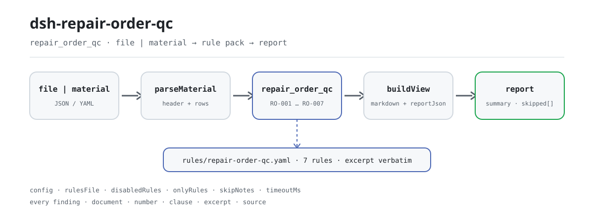

<div align="center">

<picture>
  <source media="(prefers-color-scheme: dark)" srcset="docs/assets/dsh-repair-order-qc-flow-dark.svg">
  
</picture>

# dsh-repair-order-qc

**核对一份机动车维修工单，逐条列出哪一行、哪一栏、差什么。**

面向维修接待与结算员的 DeepSeek Harness 检查器：规则库与代码分离，7 条规则各带条款出处，只列差异，不下结论。

[安装](#三步上手) · [配置](#配置) · [FAQ](#faq) · [简体中文](README.md) · [English](README.en.md) · [Español](README.es.md) · [Português](README.pt.md) · [हिन्दी](README.hi.md)

[](LICENSE)
[](#兼容性)
[](https://www.npmjs.com/package/dsh-repair-order-qc)
[](https://github.com/PerryLink/dsh-repair-order-qc/actions/workflows/ci.yml)
[](#兼容性)

[](https://github.com/PerryLink/dsh-repair-order-qc/stargazers)
[](https://www.npmjs.com/package/dsh-repair-order-qc)
[](https://dshfind.com/plugins/PerryLink/dsh-repair-order-qc?ref=badge)
[](https://securityscorecards.dev/viewer/?uri=github.com/PerryLink/dsh-repair-order-qc)
[](https://dsh.market/)
[](https://gitee.com/perrylink/dsh-repair-order-qc)

```sh
dsh plugin --profile <name> add dsh-repair-order-qc
```

</div>

<sub>社区插件，与 DeepSeek 官方无关。唯一仓库：<https://github.com/PerryLink/dsh-repair-order-qc>（Gitee 为镜像）。</sub>

## 它是什么

`dsh-repair-order-qc` 读取一份机动车维修工单——车辆表头加每个项目一行——核对这份工单自身的齐备与算术：客户反映与施工内容是否记录、项目名称栏是否填写、数量、单价与金额是否可解析、金额是否等于数量乘单价、明细金额合计是否等于结算总额、结算总额是否等于配件费加工时费减折扣、进厂日期是否不晚于出厂日期、工单号在工单内是否唯一、项目名称栏是否残留模板占位符。

它读文件、出清单：不联网、不调用模型、不写盘，同一份材料可反复核对；换一份规则库就换一套检查。

维修是否必要、收费是否合理、配件是否原厂，它不判断——那需要车辆的实际状况、技术标准与维修合同。

## 三步上手

1. **安装**（已发布到 npm）：

   ```sh
   # npm 通道（已发布版本）
   dsh plugin --profile web add dsh-repair-order-qc
   # tarball 通道：本仓库 pnpm pack 后
   dsh plugin --profile web add ./dsh-repair-order-qc-<version>.tgz
   ```

   从源码 checkout 直接运行要先 `pnpm install && pnpm run build`：入口 `main` 指向构建产物 `lib/index.mjs`，不对着源码跑。

2. **最小配置**（默认即可用；bundle patch 只 insert 一行，不需要额外配置）：

   ```yaml
   - insert:
       - id: dsh-repair-order-qc
         name: dsh-repair-order-qc
   ```

3. **验证已生效**：

   ```sh
   dsh --profile web --dump-config | grep -A2 'id: dsh-repair-order-qc'
   ```

   再跑一遍自带样例，真实输出如下（原样录自 `docs/assets/quickstart.log`）：

   ```sh
   pnpm run build && node samples/quickstart/run.mjs
   ```

   ```text
   $ node samples/quickstart/run.mjs
   repair_order_qc: 2 issue(s) — error 0, warn 2, info 0
   skipped: 0
   ```

   材料在 `samples/quickstart/input/RO-001-unsafe.json`，期望摘要见 `samples/quickstart/expected/result.json`，截图见 [docs/assets/quickstart.png](docs/assets/quickstart.png)。

**卸载**：`dsh plugin --profile web remove dsh-repair-order-qc`（或删掉 profile patch 里那一行）。

<details>
<summary>从 DSH Desktop 市场安装</summary>

所有 PerryLink 插件均可在 DSH Desktop 内置市场中浏览：**市场 → 来源 → 添加来源 → 粘贴** `https://perrylink-dsh-catalog.perrylink.workers.dev/catalog-source.json` **→ 选中**。安装仍需通过市场的 npm 身份校验与你的确认。

</details>

## 核心能力

- **一条命令核对整张工单** —— 注册 `repair_order_qc` 工具，接收 `file` 或 `material`（JSON / YAML），一次跑完 7 条规则。
- **规则库是数据，不是代码** —— 7 条规则写在 `rules/repair-order-qc.yaml`（规则库版本 `2026.1`），替换该文件即切换规则集，不用改 TypeScript。
- **每条差异都可溯源** —— 每条发现都带 `document` / `number` / `clause` / `excerpt` / `source`，写明依据哪份文件、哪一条、原文怎么写的、从哪读到的。
- **严重级跟证据走** —— 只有逐字读到条款原文的检查才允许 `error`；只能由原则推论的封顶 `warn`，本机构阈值封顶 `info`，这条纪律在规则库加载期强制，不靠自觉。
- **空结果不等于没问题** —— 跑不了的检查进 `skipped` 并写明原因（缺栏、被配置停用……），不会静默通过。
- **只列差异，不下结论** —— 不判合规、不认定责任、不替代审核人；报告固定带免责声明，措辞守卫会拦下定语式表述。
- **纯本地** —— 不联网、不调用模型、不写盘；材料与报告都留在你自己的机器和宿主的会话记录里。

### 输出长什么样

| 字段 | 含义 |
|---|---|
| `summary` | `error` / `warn` / `info` 三档计数 |
| `issueCount` / `skippedCount` | 差异条数 / 未执行检查条数 |
| `markdown` | 给人看的清单（工具渲染的就是它） |
| `reportJson` | 同一份报告的 JSON 串，便于下游处理 |
| `rulesetVersion` | 规则库版本，报告可复现的前提 |

### 示例

**详细走查** —— 工具 `repair_order_qc`。

**输入**

~~~json
{"customer":"某某客户","vehicle":"某某车型","rows":[{"工单号":"WX-2026-0018","项目名称":"前制动片","客户反映":"","施工内容":""}]}
~~~

**输出**

~~~json
{
  "id": "dsh-repair-order-qc.RO-001.de09b5a6",
  "ruleId": "RO-001",
  "severity": "warn",
  "locator": {
    "row": 1,
    "field": "customerConcern"
  },
  "found": "第 1 行 customerConcern、workDone 都为空",
  "expected": "customerConcern、workDone 至少应填写一项",
  "fix": "补填客户反映与施工内容；本条只核对是否记录，不判断维修是否必要"
}
~~~

*Observed from `dsh-repair-order-qc/tests/fixtures/RO-001/RO-001-unsafe.json (cases.json expects 1×RO-001); executed parseMaterial+runCheck, checkedAt=2026-10-06T00:00:00.000Z`*

规则库不伪造引文，因此每条发现都会同时写明所引条款，以及该依据是逐字条文还是原则性推论。

| 你会问 | 它怎么答 |
|---|---|
| 一行写着数量 2、单价 180，金额却填了 400，能查出来吗？ | 能。`RO-002` 会报出该行：2 × 180 = 360，而金额栏写的是 400。本条只在数量、单价、金额三栏都可解析为数值时执行，容差 `0.01`，用于容纳小数进位。它不判断单价是否合理、该项目是否应当收费。 |
| 各行金额加起来，与材料表头写的结算总额对不上。 | `RO-003` 会把 `amount` 一栏相加，与材料表头的结算总额 `total` 比较，并报出参与相加的行数与差额。容差 `0.01`。它只做这个加法核对，不判断各项收费是否合理。 |
| 我们的工单没有配件费合计与工时费合计两栏，还能查出结算总额不对吗？ | 不能，而且它会说明这一点。`RO-004` 核对配件费加工时费减折扣是否等于结算总额；材料没有 `partsTotal` 与 `laborTotal` 两栏合计时，本条在 `skipped` 中报告自己，不假定任何构成。它的折扣栏口径是减免金额；若台账登记的是折扣率，应停用本条或改用其它检查。 |
| 出厂日期早于进厂日期。 | `RO-005` 会报出该行：它比较进厂日期与出厂日期，进厂日期晚于出厂日期时报出该行。同一天视为不晚于；无法解析的日期单独报在该行上，不会静默放过；它不判断维修工期是否合理。 |
| 同一个工单号出现在两行上。 | `RO-006` 会报出重复的工单号，因为重复会让费用被重复计算，也会让工单与档案无法对应；比较时忽略空白字符。同一张工单分多行登记不同项目属正常情形——请在项目名称栏区分这些行，而不是重复工单号。本条只核对唯一性。 |
| 项目名称栏还是【】、待填这样的字样。 | `RO-007` 会报出残留的占位符，因为没有真实项目的工单不能结算。它查找的字样就是它自己规则库里那份 `terms` 清单，可按本机构模板调整。它只核对是否出现这些字面字样，不判断表述是否恰当。 |

### 材料格式

支持 JSON 与 YAML，材料是「车辆表头 + 每个项目一行」：

~~~yaml
customer: 某某客户
vehicle: 某某车型
mileage: '48600'
partsTotal: '360'
laborTotal: '200'
discount: '0'
total: '560'
rows:
  - { 工单号: WX-2026-0018, 进厂日期: 2026-03-02, 出厂日期: 2026-03-04,
      项目名称: 前制动片, 数量: '2', 单价: '180', 金额: '360',
      客户反映: 刹车时有异响, 施工内容: 更换前制动片一副并试车 }
~~~

列名不区分大小写，并忽略空格、下划线与连字符；台账自己的列名会保留，因此发现里写的就是它读到的那个栏名。整单只写一次的数字（配件费合计、工时费合计、结算总额）可以放在表头，算术检查会去表头找。字段在读取层是可选的，由检查引擎校验，因此部分导出的材料会产生「缺项」类差异，而不是让程序崩溃。Excel 台账可先转成 JSON 或 YAML（平台支持时也可在对话里代转）；工具只读材料，不改原件。

## 规则与依据

### 7 条规则

| 规则 | 检查 | 级别 | 依据类型 |
|---|---|---|---|
| `RO-001` | 客户反映与施工内容应至少记录一项 | warn | direct |
| `RO-002` | 金额应等于数量 × 单价 | warn | direct |
| `RO-003` | 明细金额合计应与结算总额一致 | warn | direct |
| `RO-004` | 结算总额应等于配件费 + 工时费 − 折扣 | warn | direct |
| `RO-005` | 出厂日期不应早于进厂日期 | warn | derived-from-principle |
| `RO-006` | 工单号在工单内应唯一 | warn | derived-from-principle |
| `RO-007` | 项目名称栏不应残留模板占位符 | warn | derived-from-principle |

### 依据的标准

| 文件 | 文号 | 引用它的规则 |
|---|---|---|
| 《机动车维修管理规定》 | 交通运输部令2021年第18号（2005 年公布，经 2015、2016、2019、2021 年四次修正，自 2005 年 8 月 1 日起施行） | RO-001, RO-002, RO-003, RO-004, RO-005, RO-006, RO-007 |

**边界：** 本插件核对一份**机动车维修工单**的算术与齐备性——客户反映与施工内容是否记录，一行金额是否等于数量 × 单价，各行金额合计是否等于结算总额，结算总额是否等于配件费加工时费减折扣，出厂是否不早于进厂，工单号的使用是否前后一致，以及是否残留占位符。它**不**判定维修是否必要、收费是否合理、是否存在过度维修，或作业是否做得妥当。

> ### ⚠️ 它核对的是算术，不是维修本身
>
> 一张工单的数字完全自洽，但其中所列作业本就不该推销出去，它照样能通过本插件。判断必要性与价格需要车辆的实际状况、技术标准与维修合同——这些本插件一样都没有。
>
> **工时单价来自台账或你的配置。** 不内置任何单价标准。本插件也不核对配件是否为正品；它只报告台账所写的内容。
>
> 有两条算术规则会读取台账的构成，**两者在无法执行时都会如实说明**：
>
> - `RO-002` 核对 `金额 = 数量 × 单价`，除非三个单元格都可解析，否则它把自己记入 `skipped`。其容差为 `0.01`，用于容纳舍入。
> - `RO-004` 核对 `配件费合计 + 工时费合计 − 折扣 = 结算总额`。减法在规则库中以**逐项符号**表达（`signs: [1, 1, -1]`），而不是一个负数系数，因此这条发现读起来就像人会写出的算式。没有配件费／工时费拆分的台账会让该规则不执行，而不是假定一种构成。
>
> **规则库不伪造引文。** `RO-001`～`RO-004` 的 `excerpt` 是 2026-10-07 取回的逐字条文（第二十六、三十三条，取证记录见 `rules/evidence/`）；`RO-005`～`RO-007` 没有可逐字引用的条文，`kind` 保持 `derived-from-principle`，严重级封顶 `warn`。`check:citations` 会把每条摘录逐段回溯到取证文件，引文门禁在 CI 里跑。

### 规则来源与核验

规则数据在 `rules/repair-order-qc.yaml`。每条规则都带文件名、文号、按原文自身编号体系的条款号、逐字摘录与来源地址。加载期强制：摘录必须是真实引文且不少于八个字符；依据仅为原则性条款（`kind: derived-from-principle`，严重级上限 `warn`）或本机构配置（`kind: institutional-configuration`，上限 `info`）的检查不得标为 `error`。夸大依据的规则库会在加载期失败，而不会产出一份看起来很有底气的报告。

条款号已对照《机动车维修管理规定》现行文本全文核验（七章五十五条，2021 年第四次修正）。三条结论塑造了这份规则库，记录在此，便于复核者看清**刻意没有主张**的东西：

1. **`RO-005` 没有明文依据。** 本规定通篇没有「出厂日期不得早于进厂日期」这一要求；第三十二条讲的是**竣工检验合格才能出厂**，与两个日期的先后无关。该条属台账自身的时间自洽，`clause` 已写明「本规定未明文」，`kind` 保持 `derived-from-principle`（封顶 `warn`）。
2. **2021 年修正只动了一处，且不在所引条文范围内。** 第四次修正删去第五十三条中的「限期整改不合格的，予以通报」；本插件所引第二十六、三十二、三十三条在 2019 与 2021 两版中一致。引用时应写「交通运输部令 2021 年第 18 号修正」，不要停在 2019 年第 20 号。
3. **「只核对算术」这个范围选择成立。** 第二十六条要求结算清单「工时费与材料费应当分项计算」并包含「维修费用明细单」，管的是**分项、明细、可追溯**，不是金额水平；第二十五条的「合理收取费用」是定性表述，未给任何金额标准——所以「单价是否合理」确实无法从台账判定。第三十条禁止的是**假冒伪劣配件**并要求配件追溯，`同质配件` 明文可用，因此「配件是否原厂」也不是本规定的判据。

未启用但**留档**的条款：第三十条（配件追溯）、第三十一条（三项检验制度）、第三十二、三十三条之外的档案要求、第三十六条（维修质量保证期：整车／总成 20000 公里或 100 日，二级维护 5000 公里或 30 日，一级维护／小修／专项 2000 公里或 10 日，以先达到者为准）。⚠️ **维修质量保证期（第三十六条）不是汽车三包的包修期**，两者依据不同，不要混用。取证与留档记录见 [`rules/evidence/clause-verification-repair-regulation.md`](rules/evidence/clause-verification-repair-regulation.md) 与 [`rules/evidence/clause-verification-jdcwxgd.md`](rules/evidence/clause-verification-jdcwxgd.md)。

## 配置

所有可调项都在 `src/config.ts` 的 Schemastery schema 里，只改 `cordis.yml` 即可生效，无需改代码。逐条阈值在规则库文件 `rules/repair-order-qc.yaml` 里。

| 键 | 类型 | 默认值 | 说明 |
|---|---|---|---|
| `rulesFile` | string | `rules/repair-order-qc.yaml` | 规则库文件路径，相对插件包根目录；替换该文件即可切换规则集版本 |
| `disabledRules` | string[] | `[]` | 要停用的规则 id 列表；每条都会出现在 `skipped` 中 |
| `onlyRules` | string[] | `[]` | 只执行这些规则 id；留空表示执行全部规则 |
| `skipNotes` | string | `""` | 附加到每条 `skipped` 说明后的备注，例如标注本机构实施细则 |
| `timeoutMs` | number | `120000` | 工具协作式超时预算（毫秒） |

规则级参数值得知道：

- `RO-002` `resultField` / `factorFields` / `tolerance` —— 一行的乘式核对，`tolerance` 出厂 `0.01`。
- `RO-003` `field` / `headerField` / `tolerance` —— 相加的列与它要对上的表头数字。
- `RO-004` `expression` —— 构成式，形如 `{ "op": "sum", "fields": [...], "signs": [1, 1, -1] }`。结算构成不同就改符号；按折扣**率**而不是减免金额登记的台账，应停用本条。
- `RO-007` `terms` —— 要查找的占位符字样清单。

profile patch 覆盖示例：

~~~yaml
- insert:
    - id: dsh-repair-order-qc
      name: dsh-repair-order-qc
      config:
        disabledRules: [RO-004]
        onlyRules: []
        skipNotes: 本机构实施细则 2026 版
        timeoutMs: 120000
~~~

## FAQ

<details>
<summary>材料会被上传或外发吗？数据存在哪？</summary>

不会。它只读你传给工具的文档内容：不联网、不带遥测、不写盘、不上传。除了工具返回值与 DSH 宿主自己的会话/日志存储之外，本包不落任何数据；那份存储由宿主控制、由宿主决定保留期，本包不会多留第二份副本。详见 [PRIVACY.md](PRIVACY.md)。

</details>

<details>
<summary>结果是「0 条差异」，是不是就没问题？某条规则没执行呢？</summary>

「0 条差异」只说明**跑了的检查没发现字面差异**，不等于工单合规。跑不了的检查一律进 `skipped` 并写明原因（缺栏、被 `disabledRules` 停用……），空结果读不成「什么都没问题」。如果工具整个没出现，先确认 `main` 指向的 `lib/index.mjs` 存在：源码 checkout 要先 `pnpm run build`，发布的 tarball 自带构建产物。

</details>

<details>
<summary>它会替我下合规结论、或者阻断结算吗？</summary>

不会。它不判合规、不认定责任、不评价维修是否必要、收费是否合理，也从不阻断任何流程；每条报告固定带免责声明，措辞守卫会拦下定语式表述。它给出的是一份可供人工复核的差异清单：哪一行、哪一栏、差什么、依据哪条。

</details>

<details>
<summary>`RO-004` 跳过了、`RO-002` 报了我认为已四舍五入的行、`RO-006` 对同一张工单报了两次，怎么办？</summary>

都是规则口径问题，不是故障。`RO-004` 需要表头同时有 `partsTotal` 与 `laborTotal` 才执行，缺了就在 `skipped` 里报告自己，不假定构成；折扣栏口径是减免金额，登记折扣率的台账应停用本条。`RO-002` 默认容差 `0.01`，报价进位更粗就调大 `tolerance`。`RO-006` 只核对唯一性：一张工单分多行登记不同项目是正常形态，若台账本就按行共享工单号，请停用该条。

</details>

<details>
<summary>装的时候报版本不兼容怎么办？`check` 报 `manifest-peers` 失败呢？</summary>

对等范围覆盖 `0.1.x` 与 `0.2.x` 两代。若运行时在其之外，可显式豁免：`dsh plugin --profile <name> allow-version dsh-repair-order-qc@0.2.11 --dsh-version <runtime> --accept-risk`。`check` 报 `manifest-peers` 失败是 `dsh-plugin-dev` 的已知上游问题：静态检查器比对的是一份早于 0.2 世代的硬编码范围，安装期以运行时校验为准。更多排障见 [TROUBLESHOOTING.md](TROUBLESHOOTING.md)。

</details>

## 安全边界

- **纯本地，无外发面。** 不发起网络请求、不调用模型、不带遥测；`package.json#dsh.demo` 也如实标注 `network: false`、`writes: []`、`external: []`。
- **依据不足的规则不可能标成 `error`。** 规则库加载期校验 `excerpt` 必须是不少于八个字符的逐字引文，并按 `kind` 封顶严重级：`derived-from-principle` 最多 `warn`，`institutional-configuration` 最多 `info`。引文门禁还会回归检查每条摘录能否在 `rules/evidence/` 的取证记录里找到原文。
- **只列差异，不下定性结论。** 报告不出现合规、违规、责任、正确性之类的断言；措辞守卫在渲染层强制这一点。
- **空结果不等于无罪。** 未执行的检查必须出现在 `skipped` 里并带原因；某条规则所需字段未配置时，它报告自己未执行，而不是默认通过。
- **注册即 effect。** 工具通过 `ctx.tools.register` 注册并返回 disposer，插件停用或热重载即撤销，不留悬挂注册。
- **不写盘。** 除工具返回值与宿主自身的会话存储外，本包不创建、不修改任何文件。

## 权限与数据

- **权限**：只读调用方传入的材料（`file` 路径或内联 `material`）；不提供任何服务键，不注册客户端 slot 或 HTTP 路由。`inject` 只有 `tools`。
- **数据**：材料内容只在本进程内参与比对；插件不保留副本、不缓存、不落盘。宿主如何记录工具结果是宿主的事，本包不追加第二份。
- **依赖**：运行时零依赖（没有 `dependencies`），peer 只依赖 Cordis、`dsh-tools` 与 Schemastery，均为宿主已装载的组件。

## 已知限制

- **只报字面差异。** 它不判断哪个值才是真的，不判断维修是否必要、收费是否合理，也不替审核人做决定；两个字段冲突时，它只列出冲突本身。
- **`RO-005`～`RO-007` 没有逐字条文。** 这三条的依据是原则性推论，`kind` 为 `derived-from-principle`，严重级封顶 `warn`；`RO-005` 的「出厂日期不早于进厂日期」在本规定里确无明文。
- **材料形态固定。** 它读的是「车辆表头 + 每个项目一行」的表格；不是这种形态的工单读不出结论，缺项会以「缺项」类差异出现，而不是猜一个值。
- **折扣口径是减免金额。** 登记折扣率、或结算构成不是「配件费 + 工时费 − 折扣」的台账，应停用 `RO-004` 或改用其它检查。
- **同一张工单分多行时 `RO-006` 会报重复。** 这是唯一性规则的预期行为；若台账本就按行共享工单号，停用该条。
- **开发形态要构建。** 源码 checkout 的 `main` 指向 `lib/index.mjs`，必须先 `pnpm run build`；发布的 npm tarball 自带 `lib/`，安装即用。
- **时间是墙上时钟。** 全部日期计算只对输入字符串做墙上时钟运算，不做时区换算；输入里的时区偏移不会参与比较。
- **上游静态检查器的已知误报。** `check` 的 `manifest-peers` 比对一份早于 0.2 世代的硬编码 peer 范围，与安装期的运行时校验不一致。

## 与其他 DSH 插件的互操作性

本插件**不干扰**同 profile 的其他插件：

- **工具面只加一个。** 只注册 `repair_order_qc`，经 `ctx.tools.register` 返回 disposer；不占用任何内置工具的裸名，卸载即撤销。
- **不提供服务键。** `inject` 只有 `tools`，不向 Cordis 注册任何 service key，因此不存在服务键冲突。
- **不占 slot、不占路由。** 包内没有浏览器半（无 `client/`），不注册客户端 slot key；也不注册任何 `webServer` 前缀。
- **patch 层只 insert 自己那一行。** `cordis.patch.yml` 只追加 `id: dsh-repair-order-qc` 一行，从不覆写内置行或他人行的 `config`。
- **无全局改写。** 不改原型、不写 `process.env`、不替换全局 fetch。
- **与兄弟检查器分工而非竞争。** 同一份材料可以同时交给别的检查器：本插件只核对维修工单自身的算术与齐备性；汽车三包由 `dsh-warranty-calc` 核对（**维修质量保证期 ≠ 三包包修期**，依据不同）；配件追溯不在本插件范围内（规则库留档未启用）。各插件各自读文件、各自出报告，不改原件、不共享状态。

## 兼容性

| 维度 | 状态 |
|---|---|
| Harness | 对等范围 `>=0.1.2-rc.1 <0.2.0 \|\| >=0.2.0-0 <0.3.0`，已实测接受 `0.2.0-rc.2` 与 `0.2.1-rc.2`；`engines.dsh` 声明 `>=0.2.1-0 <0.3.0`，0.2.1 起由宿主强制执行 |
| Node | `^22.19.0 \|\| >=24.0.0` |
| 平台 | 全平台（纯 ESM；无原生代码、无联网、不调用模型） |
| 工具模式 | `native` / `ptc` 均可；批量校验整个月的工单建议 `ptc`，schema 成本只付一次 |
| 材料 | JSON / YAML；车辆表头 + `rows` 列表 |

## 生态与质量

- [Gitee 镜像](https://gitee.com/perrylink/dsh-repair-order-qc)（同步镜像，以 GitHub 为准）
- [dshfind 插件页](https://dshfind.com/plugins/PerryLink/dsh-repair-order-qc)（安装量与排名）
- [OpenSSF Scorecard 报告](https://securityscorecards.dev/viewer/?uri=github.com/PerryLink/dsh-repair-order-qc)（由 [.github/workflows/scorecard.yml](.github/workflows/scorecard.yml) 驱动）
- [DSH Market](https://dsh.market/)（已上架）

## 开发

```sh
pnpm install
pnpm run typecheck          # tsc --noEmit
pnpm test                   # vitest，共享表格插件套件 + 逐条规则一对合规/违规夹具
pnpm run build              # tsdown -> lib/index.mjs + lib/index.d.mts
pnpm run verify:self-contained
pnpm run check:lockfile
pnpm run check:readmes      # README 一致性（英文版对齐中文版）
pnpm run check:citations    # 每条摘录都能在 rules/evidence/ 里找到原文
pnpm pack                   # 发布 tarball
node samples/quickstart/run.mjs   # 需要先 build
```

`node ../scripts/sync-shared.mjs dsh-repair-order-qc` 把 `../_shared` 的共享件同步进 `src/shared/`；每次改动共享件后都要重跑。插件是**数据驱动**的：`src/model.ts` 声明表格形状，共享件提供读取层与检查引擎，规则库声明每一条检查。

目录布局：

| 路径 | 作用 |
|---|---|
| `src/index.ts` | 函数式插件入口：`name` / `inject` / `Config` / `apply`，注册 `repair_order_qc` 并解析规则库 |
| `src/config.ts` | Schemastery schema，全部可调项都在这 |
| `src/model.ts` | 表格形状与材料契约：列名别名、`rows` 键、表头字段；`parseMaterial` / `runCheck` 由共享件提供 |
| `src/view.ts` | 面向模型的报告投影，`output.schema` 与它对齐 |
| `src/shared/` | 共享件（规则库加载、报告形状、YAML 子集、日历运算、措辞守卫、表格工具），复制进来而非外部依赖 |
| `rules/repair-order-qc.yaml` | 规则库，7 条规则；`rules/evidence/` 是每条引文的取证记录 |
| `tests/` | vitest；每条规则一对合规/违规夹具 |

Topics：`deepseek-harness`, `dsh`, `dsh-plugin`, `cordis`, `repair`, `order`

README 配图由 [`scripts/gen-readme-assets.py`](scripts/gen-readme-assets.py) 程序化生成（Python + Pillow，深浅两版 SVG 流程图），可重复执行；旧的单版 `dsh-repair-order-qc-flow.svg`、终端截图与演示 GIF 保留不动，以免外链失效。

## 家族与致谢

本项目是 [PerryLink](https://github.com/PerryLink) 维护的 DeepSeek Harness 插件家族成员（全部 Apache-2.0）。如果这个插件帮到了你，**给个 star**——它不解锁任何功能，但会让下一个人更容易找到它。

- [@PerryLink](https://github.com/PerryLink) —— 创建者与维护者：规则库与检查内核、引文门禁与取证记录、`repair_order_qc` 工具、五语文档。

按材料选核查器（家族完整索引）：<https://perrylink.github.io/zh/checkers/choose/> · [全部插件](https://github.com/PerryLink)

## License

[LICENSE](LICENSE)（Apache License 2.0）© 2026 dsh-repair-order-qc contributors

<p align="center"><sub>Apache-2.0 · 社区插件，与 DeepSeek 无关。</sub></p>
