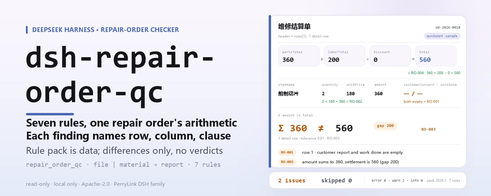

<div align="center">

<picture>
  <source media="(prefers-color-scheme: dark)" srcset="docs/assets/dsh-repair-order-qc-hero-en-dark.webp">
  
</picture>

# dsh-repair-order-qc

**Verifique uma ordem de reparo de veículos e receba uma lista linha a linha: qual linha, qual coluna e o que diverge.**

Um verificador do DeepSeek Harness para a recepção da oficina e o faturamento: o pacote de regras é dado, cada uma das sete regras carrega sua citação, e ele apenas lista diferenças — nunca julga.

[Instalar](#instalação-em-três-passos) · [Configuração](#configuração) · [FAQ](#faq) · [简体中文](README.md) · [English](README.en.md) · [Español](README.es.md) · [Português](README.pt.md) · [हिन्दी](README.hi.md)

[](LICENSE)
[](#compatibilidade)
[](https://www.npmjs.com/package/dsh-repair-order-qc)
[](https://github.com/PerryLink/dsh-repair-order-qc/actions/workflows/ci.yml)
[](#compatibilidade)

[](https://github.com/PerryLink/dsh-repair-order-qc/stargazers)
[](https://www.npmjs.com/package/dsh-repair-order-qc)
[](https://dshfind.com/plugins/PerryLink/dsh-repair-order-qc?ref=badge)
[](https://securityscorecards.dev/viewer/?uri=github.com/PerryLink/dsh-repair-order-qc)
[](https://dsh.market/)
[](https://gitee.com/perrylink/dsh-repair-order-qc)

```sh
dsh plugin --profile <name> add dsh-repair-order-qc
```

</div>

<sub>Plugin da comunidade, sem afiliação com a DeepSeek. Repositório canônico: <https://github.com/PerryLink/dsh-repair-order-qc> (o Gitee é um espelho).</sub>

## O que é

`dsh-repair-order-qc` lê uma ordem de reparo de veículos — o cabeçalho do veículo mais uma linha por item — e verifica a completude e a aritmética dessa própria ordem: se a manifestação do cliente e o serviço executado estão registrados, se a coluna do nome do item está preenchida, se quantidade, preço unitário e valor podem ser interpretados, se o valor é igual a quantidade × preço unitário, se a soma dos valores das linhas bate com a cifra de liquidação, se a cifra de liquidação é igual a peças mais mão de obra menos desconto, se a data de entrada não é posterior à data de entrega, se o número da ordem é único dentro da ordem e se sobrou algum marcador de modelo na coluna do nome do item.

Ele lê um arquivo e devolve uma lista: sem rede, sem chamada de modelo, sem gravação em disco, então o mesmo material pode ser verificado repetidamente; troque o pacote de regras e o conjunto de regras muda.

Se a reparação era necessária, se a cobrança é razoável, se a peça é original — ele não julga nada disso: isso exige o estado real do veículo, as normas técnicas e o contrato de reparo.

<picture>
  <source media="(prefers-color-scheme: dark)" srcset="docs/assets/dsh-repair-order-qc-flow-v5-dark.svg">
  
</picture>

## Instalação em três passos

1. **Instalar** (publicado no npm):

   ```sh
   # canal npm (versões publicadas)
   dsh plugin --profile web add dsh-repair-order-qc
   # canal tarball: após pnpm pack neste repositório
   dsh plugin --profile web add ./dsh-repair-order-qc-<version>.tgz
   ```

   Rodar a partir de um checkout do código exige antes `pnpm install && pnpm run build`: o `main` aponta para o artefato compilado `lib/index.mjs`, nunca para o código-fonte.

2. **Configuração mínima** (os padrões já servem; o patch do bundle insere uma linha e não precisa de mais nada):

   ```yaml
   - insert:
       - id: dsh-repair-order-qc
         name: dsh-repair-order-qc
   ```

3. **Verificar que montou**:

   ```sh
   dsh --profile web --dump-config | grep -A2 'id: dsh-repair-order-qc'
   ```

   Depois execute o exemplo incluído; a saída real é (copiada de `docs/assets/quickstart.log`):

   ```sh
   pnpm run build && node samples/quickstart/run.mjs
   ```

   ```text
   $ node samples/quickstart/run.mjs
   repair_order_qc: 2 issue(s) — error 0, warn 2, info 0
   skipped: 0
   ```

   O material está em `samples/quickstart/input/RO-001-unsafe.json`, o resumo esperado em `samples/quickstart/expected/result.json` e a captura de tela em [docs/assets/quickstart.png](docs/assets/quickstart.png).

**Desinstalar**: `dsh plugin --profile web remove dsh-repair-order-qc` (ou remova a linha do patch do perfil).

<details>
<summary>Instalar pelo mercado do DSH Desktop</summary>

Todos os plugins PerryLink aparecem no mercado embutido do DSH Desktop: **Mercado → Fontes → Adicionar fonte → colar** `https://perrylink-dsh-catalog.perrylink.workers.dev/catalog-source.json` **→ selecionar**. A instalação continua exigindo a checagem de identidade npm do mercado e a sua confirmação.

</details>

## Capacidades principais

- **Um comando verifica a ordem inteira** — registra a ferramenta `repair_order_qc`, aceita `file` ou `material` (JSON / YAML) e executa as sete regras de uma vez.
- **O pacote de regras é dado, não código** — as sete regras ficam em `rules/repair-order-qc.yaml` (versão do pacote `2026.1`); substituir esse arquivo troca o conjunto de regras sem mexer em TypeScript.
- **Cada diferença é rastreável** — cada achado carrega `document` / `number` / `clause` / `excerpt` / `source`: qual documento, qual cláusula, o que o texto diz e de onde foi lido.
- **A gravidade segue a evidência** — só uma verificação cujo texto de cláusula foi lido literalmente pode ser `error`; base apenas de princípio fica limitada a `warn` e limiar de política local a `info`. O carregador do pacote de regras impõe isso em vez de confiar no autor.
- **Lista vazia não é certidão** — toda verificação que não pode rodar é informada em `skipped` com o motivo (coluna ausente, desativada por configuração…); nada passa em silêncio.
- **Só diferenças, sem sentença** — sem conclusão de conformidade, sem atribuição de responsabilidade, sem substituir o revisor; todo relatório leva o aviso e um guardião de redação bloqueia formulações taxativas.
- **Somente local** — sem rede, sem chamada de modelo, sem gravação em disco; o material e o relatório ficam na sua máquina e no registro de sessão do próprio host.

### Como é a saída

| Campo | Significado |
|---|---|
| `summary` | contagens dos níveis `error` / `warn` / `info` |
| `issueCount` / `skippedCount` | número de diferenças / de verificações não executadas |
| `markdown` | a lista legível (é isto que a ferramenta renderiza) |
| `reportJson` | o mesmo relatório como string JSON, para processamento posterior |
| `rulesetVersion` | a versão do pacote de regras, pré-condição de um relatório reproduzível |

### Exemplos

**Passo a passo detalhado** — ferramenta `repair_order_qc`.

**Entrada**

~~~json
{"customer":"某某客户","vehicle":"某某车型","rows":[{"工单号":"WX-2026-0018","项目名称":"前制动片","客户反映":"","施工内容":""}]}
~~~

**Saída**

~~~json
{
  "id": "dsh-repair-order-qc.RO-001.de09b5a6",
  "ruleId": "RO-001",
  "severity": "warn",
  "locator": {
    "row": 1,
    "field": "customerConcern"
  },
  "found": "第 1 行 customerConcern、workDone 都为空",
  "expected": "customerConcern、workDone 至少应填写一项",
  "fix": "补填客户反映与施工内容；本条只核对是否记录，不判断维修是否必要"
}
~~~

*Observed from `dsh-repair-order-qc/tests/fixtures/RO-001/RO-001-unsafe.json (cases.json expects 1×RO-001); executed parseMaterial+runCheck, checkedAt=2026-10-06T00:00:00.000Z`*

O pacote de regras não inventa citações, então cada achado nomeia a cláusula em que se apoia e se essa base é texto literal ou um princípio.

| Você pergunta | O que ele responde |
|---|---|
| Uma linha diz quantidade 2, preço unitário 180 e um valor de 400 — a verificação percebe? | Sim. `RO-002` aponta essa linha, porque 2 × 180 = 360 enquanto a célula do valor diz 400. A regra só roda quando quantidade, preço unitário e valor podem ser lidos como números, e sua tolerância é `0.01` para arredondamento. Não julga se o preço unitário é razoável nem se o item deveria ter sido cobrado. |
| Os valores das linhas não batem com a cifra de liquidação escrita no cabeçalho do material. | `RO-003` soma a coluna `amount` e compara esse total com a cifra de liquidação `total` declarada no cabeçalho do material, informando quantas linhas somou e o tamanho da diferença. A tolerância é `0.01`. Só faz essa soma; não julga se as cobranças individuais são razoáveis. |
| Nossas ordens não trazem total de peças nem total de mão de obra — ainda assim dá para saber que a cifra de liquidação está errada? | Não, e ele diz isso. `RO-004` verifica peças mais mão de obra menos desconto contra a cifra de liquidação e se informa em `skipped` quando o material não traz os totais `partsTotal` e `laborTotal`, em vez de supor uma composição. Sua coluna de desconto significa valor de abatimento; um registro que anote taxa de desconto deve desativar a regra ou usar outra verificação. |
| A data de entrega é anterior à data de entrada. | `RO-005` aponta essa linha: compara a data de entrada com a de entrega e aponta a linha quando a entrada é posterior à entrega. O mesmo dia conta como não posterior, uma data que ele não consegue interpretar é informada na própria linha em vez de ser ignorada, e ele não julga se a reparação levou um tempo razoável. |
| O mesmo número de ordem aparece em duas linhas. | `RO-006` aponta o número repetido, porque isso duplicaria as cobranças e quebraria o vínculo entre a ordem e seu arquivo; espaços são ignorados na comparação. Uma ordem distribuída em várias linhas de itens é uma forma legítima — diferencie essas linhas na coluna do nome do item em vez de repetir o número. A regra só verifica unicidade. |
| A célula do nome do item ainda diz um marcador de modelo (colchetes de largura total ou «a preencher»). | `RO-007` aponta o marcador residual, porque uma ordem sem item real não pode ser liquidada. A lista de `terms` que ele procura é a do próprio pacote de regras e pode ser ajustada ao seu modelo. Ele só verifica se essas cadeias literais aparecem, não se a redação é adequada. |

### Formato do material

Aceita JSON e YAML; o material é «cabeçalho do veículo + uma linha por item»:

~~~yaml
customer: 某某客户
vehicle: 某某车型
mileage: '48600'
partsTotal: '360'
laborTotal: '200'
discount: '0'
total: '560'
rows:
  - { 工单号: WX-2026-0018, 进厂日期: 2026-03-02, 出厂日期: 2026-03-04,
      项目名称: 前制动片, 数量: '2', 单价: '180', 金额: '360',
      客户反映: 刹车时有异响, 施工内容: 更换前制动片一副并试车 }
~~~

Os nomes de coluna são comparados sem diferenciar maiúsculas de minúsculas e ignorando espaços, sublinhados e hífens; os nomes próprios do registro são preservados, então um achado nomeia a coluna que realmente leu. As cifras declaradas uma vez para a ordem inteira (totais de peças e mão de obra, cifra de liquidação) podem ficar no cabeçalho, e as verificações aritméticas as encontram lá. Os campos são opcionais na camada de leitura e validados pelo motor de verificação, então um material exportado pela metade gera diferenças de «valor ausente» em vez de quebrar. Um registro em Excel pode ser convertido antes para JSON ou YAML (também no chat, se a plataforma permitir); a ferramenta apenas lê o material e nunca modifica o original.

## Regras e fontes

### As sete regras

| Regra | Verificação | Gravidade | Tipo de base |
|---|---|---|---|
| `RO-001` | a manifestação do cliente e o serviço executado são registrados ao menos uma vez | warn | direct |
| `RO-002` | o valor é igual a quantidade × preço unitário | warn | direct |
| `RO-003` | a soma dos valores das linhas bate com a cifra de liquidação | warn | direct |
| `RO-004` | o total é igual a peças + mão de obra − desconto | warn | direct |
| `RO-005` | a data de entrega não é anterior à de entrada | warn | derived-from-principle |
| `RO-006` | o número da ordem é único dentro da ordem | warn | derived-from-principle |
| `RO-007` | a coluna do nome do item não mantém marcadores de modelo | warn | derived-from-principle |

### As normas em que se apoia

| Documento | Número | Regras que o citam |
|---|---|---|
| Disposições sobre a administração da manutenção de veículos automotores | Portaria do Ministério dos Transportes nº 18/2021 (promulgada em 2005; alterada quatro vezes em 2015, 2016, 2019 e 2021; em vigor desde 1º de agosto de 2005) | RO-001, RO-002, RO-003, RO-004, RO-005, RO-006, RO-007 |

**Limite:** este plugin verifica uma **ordem de reparo de veículos automotores** quanto à aritmética e à completude — que a manifestação do cliente e o serviço executado estejam registrados, que o valor de uma linha seja igual a quantidade × preço unitário, que a soma das linhas bata com a cifra de liquidação, que a cifra de liquidação seja igual a peças mais mão de obra menos desconto, que a entrega não anteceda a entrada, que o número da ordem seja usado de forma coerente e que nenhum marcador sobreviva. Ele **não** decide se uma reparação era necessária, se uma cobrança é razoável, se houve venda excessiva de serviços nem se o serviço foi bem feito.

> ### ⚠️ Ele verifica a aritmética, não a reparação
>
> Uma ordem com cifras perfeitamente coerentes para um serviço que nunca deveria ter sido vendido passa por este plugin. Julgar necessidade e preço exige o estado real do veículo, as normas técnicas e o contrato de reparo: este plugin não tem nada disso.
>
> **A tarifa de mão de obra vem do registro ou da sua configuração.** Nenhuma tarifa padrão está embutida. Ele também não verifica se a peça é original; informa o que o registro diz.
>
> Duas regras aritméticas leem a composição do registro e **ambas avisam quando não podem rodar**:
>
> - `RO-002` verifica `valor = quantidade × preço unitário` e se informa em `skipped` a menos que as três células sejam interpretáveis. Sua tolerância é `0.01`, para arredondamento.
> - `RO-004` verifica `total de peças + total de mão de obra − desconto = cifra de liquidação`. A subtração é expressa como **sinal por termo** no pacote de regras (`signs: [1, 1, -1]`) e não como escala negativa, então o achado se lê como a aritmética que uma pessoa escreveria. Um registro sem detalhamento de peças/mão de obra deixa a regra sem executar em vez de supor uma composição.
>
> **O pacote de regras não inventa citações.** O `excerpt` de `RO-001`–`RO-004` é texto literal obtido em 2026-10-07 (artigos 26 e 33; os registros de verificação estão em `rules/evidence/`); `RO-005`–`RO-007` não têm cláusula citável literalmente, então seu `kind` permanece `derived-from-principle` e a gravidade fica limitada a `warn`. O `check:citations` rastreia cada segmento dos excertos até esses registros, e a porta de citações roda na CI.

### Origem e verificação das regras

Os dados das regras ficam em `rules/repair-order-qc.yaml`. Cada regra traz um documento, um número, uma cláusula na numeração própria da fonte, um excerto literal e a URL de onde ele foi lido. O carregador impõe que um excerto seja citação real de pelo menos oito caracteres, e que uma verificação cuja base seja só um princípio geral (`kind: derived-from-principle`, limitada a `warn`) ou uma política local (`kind: institutional-configuration`, limitada a `info`) nunca possa ser declarada `error`. Um pacote que exagera sua base falha ao carregar em vez de produzir um relatório com tom seguro.

Os números de cláusula foram conferidos com o texto completo vigente das Disposições (sete capítulos, 55 artigos, com a alteração de 2021). Três conclusões moldaram o pacote e ficam registradas aqui para que um revisor veja o que deliberadamente **não** se afirma:

1. **`RO-005` não tem cláusula explícita.** As Disposições não contêm exigência de que a data de entrega não seja anterior à de entrada; o artigo 32 trata de **entregar somente após passar na inspeção de conclusão**, o que nada diz sobre a ordem das duas datas. A regra é, portanto, a coerência temporal do próprio registro, seu campo `clause` diz isso e seu `kind` permanece `derived-from-principle` (limitada a `warn`).
2. **A alteração de 2021 mudou exatamente uma coisa, e fora dos artigos citados.** A quarta alteração suprimiu uma frase do artigo 53; os artigos 26, 32 e 33 são idênticos nos textos de 2019 e de 2021. Cite «Portaria do Ministério dos Transportes nº 18/2021, alterada», não a Portaria nº 20 de 2019.
3. **«Só aritmética» é uma decisão de escopo que o texto sustenta.** O artigo 26 exige que a lista de liquidação expresse **separadamente** mão de obra e materiais e inclua um **detalhamento de custos**: ele rege itemização, detalhe e rastreabilidade, não o nível dos preços. O «cobrar de forma razoável» do artigo 25 é qualitativo e não fixa valor; por isso «o preço unitário é razoável?» realmente não se decide a partir de um registro. O artigo 30 proíbe **peças falsificadas ou de má qualidade** e exige rastreabilidade, e admite expressamente peças de qualidade equivalente, então «esta peça é original?» também não é critério dessa norma.

Artigos **registrados mas não ativados**: artigo 30 (rastreabilidade de peças), artigo 31 (os três regimes de inspeção), os requisitos de arquivo além dos artigos 32 e 33, e o artigo 36 (prazos de garantia da qualidade da reparação: 20.000 km ou 100 dias para veículo completo ou conjunto, 5.000 km ou 30 dias para manutenção de segundo nível, 2.000 km ou 10 dias para manutenção de primeiro nível, reparo menor ou serviço especial — o que ocorrer primeiro). ⚠️ **O prazo de garantia da reparação (artigo 36) não é o prazo de garantia das «três garantias» do automóvel**; os dois se apoiam em documentos distintos e não devem ser misturados. A verificação completa e os artigos registrados sem uso estão em [`rules/evidence/clause-verification-repair-regulation.md`](rules/evidence/clause-verification-repair-regulation.md) e [`rules/evidence/clause-verification-jdcwxgd.md`](rules/evidence/clause-verification-jdcwxgd.md).

## Configuração

Todos os parâmetros ficam no esquema Schemastery de `src/config.ts`; basta mudar o `cordis.yml` para valer, sem tocar em código. Os limiares de cada verificação ficam no pacote de regras `rules/repair-order-qc.yaml`.

| Chave | Tipo | Padrão | Descrição |
|---|---|---|---|
| `rulesFile` | string | `rules/repair-order-qc.yaml` | Caminho do pacote de regras, relativo à raiz do pacote; substituir o arquivo troca a versão do conjunto de regras |
| `disabledRules` | string[] | `[]` | Ids de regras a desativar; cada uma aparece em `skipped` |
| `onlyRules` | string[] | `[]` | Rodar somente estes ids; vazio roda todas as regras |
| `skipNotes` | string | `""` | Nota anexada a cada motivo de `skipped`, por exemplo para citar sua política local |
| `timeoutMs` | number | `120000` | Orçamento de timeout cooperativo da ferramenta, em milissegundos |

Parâmetros por regra que vale conhecer:

- `RO-002` `resultField` / `factorFields` / `tolerance` — a multiplicação da linha; `tolerance` vale `0.01` por padrão.
- `RO-003` `field` / `headerField` / `tolerance` — a coluna somada e a cifra de cabeçalho com que ela deve bater.
- `RO-004` `expression` — a composição, como `{ "op": "sum", "fields": [...], "signs": [1, 1, -1] }`. Mude os sinais se a sua liquidação se compõe de outro modo; um registro que anote uma **taxa** de desconto em vez de um valor deve desativar a regra.
- `RO-007` `terms` — as cadeias de marcador procuradas.

Exemplo de sobrescrita no patch do perfil:

~~~yaml
- insert:
    - id: dsh-repair-order-qc
      name: dsh-repair-order-qc
      config:
        disabledRules: [RO-004]
        onlyRules: []
        skipNotes: política local 2026
        timeoutMs: 120000
~~~

## FAQ

<details>
<summary>O material é enviado para algum lugar? Onde os dados ficam?</summary>

Não. Ele só lê o conteúdo do documento que você passa às ferramentas: sem rede, sem telemetria, sem gravação em disco, sem upload. Além do resultado da ferramenta e do armazenamento de sessão/logs do próprio host DSH, este pacote não guarda nada; esse armazenamento é controlado pelo host e sua retenção é decisão do host — este pacote nunca adiciona uma segunda cópia. Veja [PRIVACY.md](PRIVACY.md).

</details>

<details>
<summary>O resultado é «0 diferenças» — isso significa que não há nada errado? E se uma regra não rodou?</summary>

«0 diferenças» significa apenas que **as verificações executadas não acharam diferença literal**; não significa que a ordem esteja em conformidade. Toda verificação que não pode rodar é informada em `skipped` com o motivo (coluna ausente, desativada por `disabledRules`…), então um resultado vazio não pode ser lido como «não há nada errado». Se a ferramenta não aparecer, confirme primeiro que existe o `lib/index.mjs` para o qual `main` aponta: um checkout do código exige `pnpm run build` e o tarball publicado já traz o artefato.

</details>

<details>
<summary>Ele vai me dar um parecer de conformidade ou bloquear uma liquidação?</summary>

Não. Ele não emite conclusão de conformidade, não atribui responsabilidade e não julga se uma reparação era necessária ou uma cobrança razoável; nunca bloqueia processo algum. Todo relatório leva o aviso e um guardião de redação bloqueia formulações taxativas. O que você recebe é uma lista de diferenças para revisão humana: qual linha, qual coluna, o que diverge e qual cláusula sustenta.

</details>

<details>
<summary>`RO-004` foi omitida, `RO-002` apontou uma linha que considero arredondada, `RO-006` informou duas vezes a mesma ordem — e agora?</summary>

As três são questões de escopo da regra, não falhas. `RO-004` só roda se o cabeçalho trouxer `partsTotal` e `laborTotal`; sem eles ela se informa em `skipped` em vez de supor uma composição. Sua coluna de desconto é valor de abatimento, então um registro que anote taxa deve desativá-la. `RO-002` tolera `0.01` por padrão: aumente `tolerance` se seu preço arredonda mais grosso. `RO-006` verifica apenas unicidade: uma ordem distribuída em várias linhas de itens é normal, e se o seu registro compartilha o número entre linhas por projeto, desative a regra.

</details>

<details>
<summary>E se a instalação informar conflito de versão, ou o `check` informar `manifest-peers` como falho?</summary>

A faixa de peers cobre as linhas `0.1.x` e `0.2.x`. Se o seu runtime ficar fora dela, conceda isenção explícita: `dsh plugin --profile <name> allow-version dsh-repair-order-qc@0.2.11 --dsh-version <runtime> --accept-risk`. A falha de `manifest-peers` é problema conhecido do `dsh-plugin-dev`: o verificador estático compara com uma faixa de peers codificada anterior à linha 0.2, enquanto a instalação é validada pelo runtime. Mais diagnóstico em [TROUBLESHOOTING.md](TROUBLESHOOTING.md).

</details>

## Limites de segurança

- **Somente local, sem superfície de saída.** Sem requisições de rede, sem chamadas de modelo, sem telemetria; `package.json#dsh.demo` também declara `network: false`, `writes: []` e `external: []`.
- **Regra com base insuficiente não pode ser `error`.** O carregador do pacote exige que `excerpt` seja citação literal de pelo menos oito caracteres e limita a gravidade por `kind`: `derived-from-principle` no máximo `warn`, `institutional-configuration` no máximo `info`. A porta de citações ainda confere que cada excerto é rastreável a um registro de verificação em `rules/evidence/`.
- **Só diferenças, sem sentença.** Os relatórios não afirmam conformidade, infração, responsabilidade nem correção; o guardião de redação impõe isso na camada de renderização.
- **Resultado vazio não é absolvição.** Uma verificação não executada deve aparecer em `skipped` com o motivo; uma regra cujos campos exigidos faltam se informa como não executada em vez de passar por padrão.
- **Registro é efeito.** A ferramenta é registrada com `ctx.tools.register`, que devolve o disposer; desativar o plugin ou recarregar a quente a remove sem deixar registro pendurado.
- **Sem gravação em disco.** Além do resultado da ferramenta e do armazenamento de sessão do host, este pacote não cria nem modifica arquivo algum.

## Permissões e dados

- **Permissões**: lê apenas o material que o chamador passa (um caminho `file` ou um `material` em linha); não oferece chave de serviço e não registra slot de cliente nem rota HTTP. O `inject` é exatamente `tools`.
- **Dados**: o material participa da comparação somente dentro deste processo; o plugin não guarda cópia, cache nem arquivo. Como o host registra os resultados da ferramenta é assunto do host; este pacote não adiciona uma segunda cópia.
- **Dependências**: zero dependências em tempo de execução (não há campo `dependencies`); os peers são Cordis, `dsh-tools` e Schemastery, todos já carregados pelo host.

## Limitações conhecidas

- **Só diferenças literais.** Não decide qual valor é o verdadeiro, nem se uma reparação era necessária ou uma cobrança razoável, nem decide pelo revisor; quando dois campos conflitam, lista o conflito em si.
- **`RO-005`–`RO-007` não têm cláusula literal.** Sua base é um princípio, `kind` é `derived-from-principle` e a gravidade fica limitada a `warn`; o «a entrega não é anterior à entrada» de `RO-005` realmente não está na norma.
- **A forma do material é fixa.** Ele lê uma tabela «cabeçalho do veículo + uma linha por item»; uma ordem em outra forma não produz conclusão, e um valor ausente aparece como diferença de valor ausente em vez de suposição.
- **A coluna de desconto significa valor de abatimento.** Um registro que anote taxa de desconto, ou cuja liquidação não seja «peças + mão de obra − desconto», deve desativar `RO-004` ou usar outra verificação.
- **`RO-006` informa repetição quando uma ordem abrange várias linhas.** É o comportamento previsto de uma regra de unicidade; se o seu registro compartilha o número entre linhas por projeto, desative-a.
- **A forma de desenvolvimento exige build.** Num checkout do código o `main` aponta para `lib/index.mjs`, então `pnpm run build` precisa rodar antes; o tarball publicado do npm traz `lib/` e funciona como instalado.
- **O tempo é de relógio de parede.** Todo cálculo de datas é aritmética de relógio de parede sobre as strings de entrada, sem conversão de fuso horário; deslocamentos na entrada nunca participam de uma comparação.
- **Falso positivo conhecido do verificador estático upstream.** O `manifest-peers` do `check` compara com uma faixa de peers codificada anterior à linha 0.2, que não concorda com a validação do runtime na instalação.

## Interoperabilidade com outros plugins DSH

Este plugin **não interfere** em outros plugins do mesmo perfil:

- **Adiciona exatamente uma ferramenta.** Só o `repair_order_qc` é registrado, via `ctx.tools.register`, que devolve o disposer; não ocupa nenhum nome nu de ferramenta embutida e desaparece ao desinstalar.
- **Sem chaves de serviço.** O `inject` é só `tools`; nenhuma chave de serviço do Cordis é registrada, então não existe conflito de chaves.
- **Sem slots, sem rotas.** O pacote não tem metade de navegador (não há `client/`), não registra chave de slot de cliente nem prefixo `webServer`.
- **A camada de patch insere apenas a própria linha.** O `cordis.patch.yml` acrescenta só a linha `id: dsh-repair-order-qc` e nunca sobrescreve o `config` de uma linha embutida ou de outro plugin.
- **Sem reescritas globais.** Sem patch de protótipo, sem escrita em `process.env`, sem substituição do fetch global.
- **Divisão de trabalho, não competição, com verificadores irmãos.** O mesmo material pode ir a outros verificadores: este plugin verifica a aritmética e a completude da própria ordem; as «três garantias» do automóvel são escopo do `dsh-warranty-calc` (**prazo de garantia da reparação não é prazo das três garantias** — bases distintas); a rastreabilidade de peças está fora deste plugin (registrada no pacote de regras mas não ativada). Cada plugin lê seu arquivo e produz seu relatório, sem modificar nada e sem compartilhar estado.

## Compatibilidade

| Dimensão | Estado |
|---|---|
| Harness | Faixa de peers `>=0.1.2-rc.1 <0.2.0 \|\| >=0.2.0-0 <0.3.0`, medida para aceitar tanto `0.2.0-rc.2` quanto `0.2.1-rc.2`; `engines.dsh` declara `>=0.2.1-0 <0.3.0`, imposto pelo host desde 0.2.1 |
| Node | `^22.19.0 \|\| >=24.0.0` |
| Plataformas | Todas (ESM puro; sem código nativo, sem rede, sem chamada de modelo) |
| Modo de ferramenta | Serve `native` e `ptc`; para um mês de ordens use `ptc` |
| Material | JSON / YAML; cabeçalho do veículo + uma lista `rows` |

## Ecossistema e qualidade

- [Espelho no Gitee](https://gitee.com/perrylink/dsh-repair-order-qc) (espelho sincronizado; o GitHub é a referência)
- [Página do plugin no dshfind](https://dshfind.com/plugins/PerryLink/dsh-repair-order-qc) (instalações e ranking)
- [Relatório OpenSSF Scorecard](https://securityscorecards.dev/viewer/?uri=github.com/PerryLink/dsh-repair-order-qc) (movido por [.github/workflows/scorecard.yml](.github/workflows/scorecard.yml))
- [DSH Market](https://dsh.market/) (listado)

## Desenvolvimento

```sh
pnpm install
pnpm run typecheck          # tsc --noEmit
pnpm test                   # vitest: a suíte compartilhada de plugins de tabela mais um par de fixtures conforme/infrator por regra
pnpm run build              # tsdown -> lib/index.mjs + lib/index.d.mts
pnpm run verify:self-contained
pnpm run check:lockfile
pnpm run check:readmes      # coerência dos README: a edição inglesa contra a fonte chinesa
pnpm run check:citations    # cada excerto é rastreável a rules/evidence/
pnpm pack                   # o tarball publicado
node samples/quickstart/run.mjs   # exige build antes
```

`node ../scripts/sync-shared.mjs dsh-repair-order-qc` copia o kit compartilhado de `../_shared` para `src/shared/`; rode de novo após cada mudança no kit. O plugin é **guiado por dados**: `src/model.ts` declara a forma da tabela, o kit compartilhado fornece o leitor e o motor de verificação, e o pacote de regras declara cada verificação.

Estrutura de diretórios:

| Caminho | Função |
|---|---|
| `src/index.ts` | entrada de plugin-função: `name` / `inject` / `Config` / `apply`, registra `repair_order_qc` e resolve o pacote de regras |
| `src/config.ts` | esquema Schemastery; todo parâmetro mora aqui |
| `src/model.ts` | forma da tabela e contrato do material: aliases de coluna, a chave `rows`, campos de cabeçalho; `parseMaterial` / `runCheck` vêm do kit compartilhado |
| `src/view.ts` | a projeção do relatório voltada ao modelo; `output.schema` a espelha |
| `src/shared/` | o kit compartilhado (carregador do pacote de regras, forma do relatório, subconjunto de YAML, aritmética de calendário, guardião de redação, utilitários de tabela), copiado em vez de importado |
| `rules/repair-order-qc.yaml` | o pacote de regras, 7 regras; `rules/evidence/` guarda o registro de verificação de cada citação |
| `tests/` | vitest; um par de fixtures conforme/infrator por regra |

Topics: `deepseek-harness`, `dsh`, `dsh-plugin`, `cordis`, `repair`, `order`

As imagens do README são geradas por programa por [`scripts/gen-readme-assets.py`](scripts/gen-readme-assets.py) — o banner hero com Pillow e o diagrama de estrutura como SVG escrito à mão — e podem ser regeradas a qualquer momento; os antigos `dsh-repair-order-qc-flow*.svg`, a captura de terminal e o GIF de demonstração ficam em `docs/assets/` para os links existentes, enquanto os READMEs referenciam apenas o novo hero (quatro arquivos, zh/en × claro/escuro) e o diagrama flow-v5 (claro e escuro).

## Família e agradecimentos

Este projeto é membro da família de plugins do DeepSeek Harness mantida pela [PerryLink](https://github.com/PerryLink) (todos Apache-2.0). Se este plugin ajudou você, **dê uma estrela**: não desbloqueia nada, mas faz a próxima pessoa encontrá-lo antes.

- [@PerryLink](https://github.com/PerryLink) — criador e mantenedor: o pacote de regras e o núcleo de verificação, a porta de citações e os registros de verificação, a ferramenta `repair_order_qc` e a documentação em cinco idiomas.

Escolha um verificador pelo material (índice completo da família): <https://perrylink.github.io/zh/checkers/choose/> · [todos os plugins](https://github.com/PerryLink)

## Licença

[LICENSE](LICENSE) (Apache License 2.0) © 2026 dsh-repair-order-qc contributors

<p align="center"><sub>Apache-2.0 · Plugin da comunidade, sem afiliação com a DeepSeek.</sub></p>
